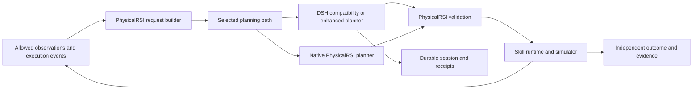
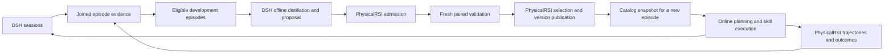

# Agent Note: DSH and PhysicalRSI embodied harness integration and evaluation

Status: proposed

English | [中文](2026-10-20-physicalrsi-phase-one-integration.zh.md)

## Problem

The delivery goal is native task-success parity with PhysicalRSI on basic tasks, with bounded time and cost overhead, and a clear success-rate improvement on complex tasks and recoverable disturbances covered by existing perception and action capabilities. Model connectivity, saved sessions, or one simulator success cannot individually satisfy this goal. Frozen controlled experiments must establish gains; they cannot be promised in advance.

PhysicalRSI already has runtime planning and development-time System 2. DSH supplies model invocation, durable sessions, and context management. Additional gains require execution feedback to change subsequent plans, recovery, and memory across subtasks. Replacing model calls alone cannot demonstrate these gains; unnecessary inference can reduce success or add latency.

## Proposal

Keep observation filtering, domain rules, skill execution, physical state, and task judgments in PhysicalRSI, connected to DSH through its public Python SDK. Provide separate compatibility and enhanced paths: the compatibility path preserves native behavior for non-inferiority testing; the enhanced path invokes DSH replanning on domain events, with PhysicalRSI validating and executing the result.

This delivery requires phase-one compatibility comparison and phase-two online replanning, recovery, and outcome acceptance. Phase zero freezes baselines and evaluation protocols. Phase-three offline skill development may be prepared in parallel but is not a prerequisite for online gains. Basic tasks retain the existing execution path without extra planning calls when no domain trigger occurs.

Implementation is partial; outcome acceptance remains open. Compatibility integration has local protocol evidence; enhanced runner integration and the frozen paired experiments remain required. Initial integration targets `general_pickup`, `arx_x5`, one environment, and the existing code-policy. Full acceptance must cover the basic, long-horizon composition, and recoverable-disturbance sets below. Conclusions exclude unvalidated policies, robots, and task scopes.

### Implementation checkpoint: 2026-10-21

The experimental [planner bundle](../../../../packages/experimental/embodied-planner/README.md) and [Python adapter](../../../../python/embodied/README.md) implement tool-free JSON planning, ordered source-image presentation, whole-turn deadlines, fresh compatibility Sessions, reset-generation rejection, runtime rotation, and immutable request/event/terminal receipts. A portable patch shares PhysicalRSI request construction and validation across the API and DSH backends and allocates episode identity before planning. Local PhysicalRSI changes are limited to the planner, skill-model lifecycle and an affected test fixture; its pre-existing worktree changes are preserved.

Local evidence includes the actual built `dsh --profile embodied-planner` through the public Python SDK and a recorded local HTTP provider. It compares exact system/user text, ordered PNG bytes, JSON response mode, temperature and output cap, and checks persisted Session logs after runtime shutdown. Two live DeepSeek `deepseek-flash` calls completed using identical domain input: native and H0 both selected the registered `pick` capability. The input is synthetic, no robot actions occurred, and this is protocol evidence only. These calls use two of the ten model calls authorized for initial integration.

The recovery coordinator implements the stop/observe/validate/commit/bind order and rejects unknown stop, stale observation/catalog, unchanged executable plans, late results and binding failures. Its deterministic provider tests do not supply RoboDojo stop semantics. T8–T14 remain open: observed-event detection, a real runner-owned stop provider, enhanced multi-turn planning and physical binding, linked native outcomes, pilot power analysis and formal G1–G4 paired acceptance. Offline skill development remains phase three. The proposal status must remain until the outcome criteria are met.

### Design rationale and complementary strengths

These limitations concern the inspected PhysicalRSI RoboDojo implementation, not a framework-wide absence of LLMs or closed-loop skills. Fixed-planner remote experiments are controlled setups and do not establish the framework's overall capabilities. Implementation uses the sources and capability inventory frozen in T0.

PhysicalRSI already supplies loadable policies/compositions, action-chunk execution, physical trajectories, memory snapshots, and independent environment scoring. Development-time System 2 adds candidate admission, independent validation, selection, and lineage. DSH contributes reusable model providers, durable sessions, context management, and an extensible agent loop for continuing decisions during task execution. Retaining these capabilities concentrates new work on domain events, plan revisions, and execution coordination, reducing duplicated infrastructure.

| Current implementation or capability limit | Task consequence | Integration mechanism and retained strength |
|---|---|---|
| `skill_model.py` selects a complete capability at episode start and retains its binding until reset. | Stable bindings support reproducibility; skills can still control execution in a closed loop, but this route lacks high-level strategy switching beyond their built-in recovery. | Retain stable execution; DSH proposes revisions after domain events, and PhysicalRSI confirms stopping, refreshes observations, and validates before switching within the pinned catalog. |
| `AgentLoop.prepare()` records subgoal advice but returns original observations to the policy. | More planning calls alone do not ensure that advice changes actual actions. | Add validated, committed plan revisions linking subgoals and capability selection to execution, and verify that revisions change subsequent behavior. |
| Memory snapshots, visual history, and execution records exist; the task planner takes explicit memory/previous_plan inputs. | These support physical execution but still need integration with cross-subtask model sessions and context management. | DSH retains decision history, failed attempts, and model calls; PhysicalRSI supplies authoritative current state rather than guessing positions, bindings, or active actions from summaries. |
| Development-time System 2 generates/evaluates candidates from controlled development feedback without an arbitrary DSH-history importer. | It can improve later skill versions; current-episode recovery and general historical-experience import still require adapters. | Implement online recovery separately from offline development; DSH extracts/proposes, while PhysicalRSI retains evidence checking, independent evaluation, selection, and publication authority. |
| Observable state, available actions, and stopping capabilities have explicit limits. | Longer reasoning cannot directly supply missing skills, observations, or reliable stopping. | Check capability coverage first; stop/report gaps online and attempt independently validated offline development. New perception models, policy weights, or robot capabilities require separate work. |

Verification entry points in the PhysicalRSI repository are `_start_episode()` in `PhysicalRSI_baselines/robodojo/skill_model.py`, `AgentLoop.prepare()` in `agent_planner.py`, `CodeProposer.propose()` in `proposal.py`, and `PhysicalRSI_core/self_harness`. They cover binding, planning advice, candidate generation, and independent selection respectively.

Three loops use different triggers to balance basic-task overhead, complex-task adaptation, and long-term improvement:

| Loop | Combined responsibility | Intended benefit |
|---|---|---|
| High-frequency execution | PhysicalRSI handles observations, control, and action chunks. | Retain existing execution without additional LLM calls during normal progress. |
| Low-frequency online planning | DSH maintains context and proposes bounded plans; PhysicalRSI supplies events, state, stop confirmation, validation, and execution. | Adapt subsequent behavior at subtask completion or failure while retaining independent physical-state and task-success judgments. |
| Offline capability development | DSH links historical evidence, extracts experience, and proposes candidates; PhysicalRSI development evaluates, selects, and publishes versions. | Convert useful experience into later capabilities using existing validation/lineage without affecting current episodes. |

For example, assume the catalog contains grasp, transport, and placement capabilities and an object drops during transport. If the current skill provides built-in recovery, it handles the failure first. If a high-level change is needed, PhysicalRSI reports the event and confirms stopping; DSH revises subgoals from fresh observations and prior attempts, and PhysicalRSI validates before execution. Unobservable object state produces uncertainty and stopping. After the task, the record may enter independent offline development rather than become a published skill directly.

DSH also needs embodied-domain adaptation: generic loop completion cannot establish environment success, text summaries are not current physical state, and terminating model processes does not establish robot stopping. Domain events, stop receipts, plan revisions, and profile adapters are pending work. The same-model/catalog/budget comparisons below test whether these combined mechanisms achieve basic non-inferiority and complex-task superiority.

### Remote environment assessment

Read-only SSH inspection on 2026-10-20 examined `/mnt/nas/qingning/projects`; the result inventory below uses a 17:52 Asia/Shanghai cutoff. Paths in this subsection are relative to that remote root. No simulator, model inference, installation, or experiment was started during this assessment.

**Assessment: usable as an integration environment and a source of successful single-task execution evidence; not yet a frozen, directly reproducible DSH comparison baseline.**

| Evidence | Observed state | Consequence |
|---|---|---|
| `envs/robodojo-sim`, `envs/robodojo-policy` | Both use Python 3.11.17. The simulator environment reports Isaac Sim 5.1.0.0 and Torch 2.7.0+cu128; WebSockets versions differ between environments. | Preserve the two interpreters and their dependency records; do not combine environments. |
| GPU inventory | NVIDIA RTX PRO 5000 72GB Blackwell; driver 580.126.09. | Suitable existing simulator host; availability must be checked again before running experiments. |
| `results/general-pickup/20261019-172643/client.log` and native result | The log records 110 steps and one success. The native `_result.json` records `eval_time=1`, `success_rate=1.0`, and layout 0 success. Three video files exist. | A real single-task code-policy execution completed. This is not a benchmark-wide success rate. |
| `results/general-pickup/policy/0c2c331c29cd4d579f2ad2884f2bbd3b/episodes/c5fa8486337442248cb0a8344d8b7115/` | Decision, binding, and execution records select `instruction-grounded-pickup`; execution records 110 delivered chunks. | Reuse the records and skill integration. Complete model-call identity and the link to the simulator run still need a unified receipt. |
| `results/general-pickup/20261019-172419/` | Process exit is 0, but the client reports `ModuleNotFoundError: PhysicalRSI_baselines` and no completed trial. | Exit code alone is invalid acceptance evidence. |
| `results/system2-pickup/` | Six completed episode records have native successful results, natural termination, exit 0, no recorded observer failures, and three nonempty videos each. Native-result byte hashes and canonical layout hashes match their receipts. | Useful controlled execution evidence; the scripts deliberately fix the planner and perturb layouts. |
| `setup/codex-bridge/smoke-result.json` | Synthetic-image remote-to-local Codex response, explicitly marked `qualification=false`. | Transport evidence only. It is not a robot-task result. |
| `results/report-finalizer-selftest/` | Contains a successful-looking report and copied result material. | Exclude report self-tests from experiment counts. |
| `physicalrsi-assets/skill-assets/` | Code skills, OpenPI, and both `pi05` checkpoint directory trees exist. A previous pickup asset verification reports 382 files. | Assets are available for inspection; current full integrity, learned-model loading, and learned-policy execution remain unverified. |

The native result for the successful October 19 run is `RoboDojo/eval_result/RoboDojo/general_pickup/physicalRSICodex/arx_x5/0_code-first-smoke/2026-10-19_17-26-46/_result.json`. Its directory contains the three camera videos. This assessment checked file presence and recorded metrics, not video content.

The controlled experiments provide the following observations. Each row represents one episode, and the two validation pairs share their respective canonical layout hash.

| Run directory under `results/system2-pickup/` | Episode | Settle actions | Delivered actions | Native success |
|---|---|---|---|---|
| `system2-pickup-20261020-171542` | `development-parent` | 60 | 110 | true |
| `system2-pickup-20261020-171949` | `validation-parent` | 60 | 110 | true |
| `system2-pickup-20261020-171949` | `validation-candidate` | 54 | 104 | true |
| `system2-pickup-next-20261020-174441` | `development-zero` | 0 | 50 | true |
| `system2-pickup-next-20261020-174441` | `validation-parent` | 54 | 104 | true |
| `system2-pickup-next-20261020-174441` | `validation-candidate` | 0 | 50 | true |

Both `setup/system2/remote_episode.py` and `remote_episode_next.py`, lines 8–15, replace `skill_model.AgentPlanner` with a fixed answer. They also select explicit perturbed layouts and create skill overlays that change phase budgets. The latter script adds privileged physical diagnostics. These observations support successful controlled execution and reduced action counts in these episodes; they do not establish LLM planning gains, generalization, or a complete proposer–evaluation–selection–inheritance loop. Privileged diagnostics must remain evaluation-only.

Current remote `agent_planner.py` already supports `api`, `codex`, and `remote-codex`; local `/Users/rockops/codes/PhysicalRSI` lacks the remote Codex backend files and has a different planner. The remote PhysicalRSI directory has no `.git`; RoboDojo has an untracked XPolicyLab policy adapter and a modified IsaacLab `setup.py`. Reconcile and preserve these changes before choosing the implementation base.

| Selected file | SHA-256 observed during inspection |
|---|---|
| Remote `PhysicalRSI/PhysicalRSI_baselines/robodojo/agent_planner.py` | `fd3ac5afe8c7b895550810222aca6c305c5192de63dd8f99376ca4d2c9c83557` |
| Local `PhysicalRSI_baselines/robodojo/agent_planner.py` | `d6f6936d5b57283c7c8affacd857356f9b1e8f8d5f54a7b6959a4e70c1cb25db` |
| `PhysicalRSI_baselines/robodojo/skill_model.py`, equal in both copies | `a9a965538b15198df7b5a9521d45af92a205ead1ceba7bca659efabbe4aba9e5` |
| Remote `setup/system2/remote_episode_next.py` | `854e2aa751fcaaf35548624591e1222c1d1ec63fe85a64fa1d766a3be6cc1982` |

The pickup configuration selects `remote-codex` at loopback port 18765. At the connectivity check, neither that port nor policy port 9999 accepted connections; this is a point-in-time observation, not a service failure diagnosis. No `node`, `pnpm`, or `dsh` executable was found on the SSH shell's PATH. A pinned DSH runtime and an accessible model route must therefore be prepared before integration execution. Do not assume the earlier Mac-to-server bridge remains available.

### Phases and completion conditions

Phase one is an integration milestone; phase two must pass to meet this delivery's outcome goal. Each phase has separate configuration and artifacts so enhanced behavior cannot contaminate compatibility comparisons.

| Phase | Deliverables | Completion condition |
|---|---|---|
| Zero: freeze native baseline and protocol | Reconcile sources, assets, strongest available native configuration, capability coverage, task partitions, and resource budgets; size the study using development pilots. | T0 complete; freeze metrics, thresholds, cases, statistical method, and stopping rules before formal evaluation. |
| One: compatible integration and basic parity | DSH planning backend, public SDK bridge, input equivalence, lifecycle, and execution evidence; retain fixed binding until reset. | T1–T7 complete; compatibility path meets G1/G2/G4; one pickup success is only a smoke test. |
| Two: online replanning and recovery | Domain events, stoppable execution, context across subtasks, bounded plan revisions, and validated skill switching. | T8–T15 complete; the final enhanced path meets G1–G4 together; complex-task gains cannot conceal basic-task regressions. |
| Three: offline skill development | Import historical development data; DSH extracts/proposes, PhysicalRSI evaluates/publishes, and new episodes consume releases. | F1–F4 accepted separately; first report online gains with a fixed catalog independently. |

### Module responsibilities

Reuse PhysicalRSI controllers and evaluation. DSH hosts planning through an experimental composition and existing extension points without moving physical actions or environment truth into the generic agent loop.

| Owner | Responsibility | Phase constraint |
|---|---|---|
| PhysicalRSI request builder | Filter observations and construct domain prompts, memory, catalogs, and ordered images. | Equivalent inputs across phase-one backends; phase two adds observable state/events without hidden evaluation identifiers. |
| PhysicalRSI plan validator | Check modes, registered operations, composition, units/coordinate frames, and preconditions. | Preserve phase-one rules; phase two checks revisions, stop receipts, state freshness, and remaining budget. |
| Python DSH bridge | SDK lifecycle, correlation IDs, deadlines, result extraction, and cross-system receipts. | One in-flight request per runtime; inference retries do not replay actions; terminating DSH is not stopping the robot. |
| DSH `embodied-planner` composition | Model routing, durable multimodal sessions, bounded planning, and context management. | Compatibility configuration has no tools or automatic summaries; enhanced configuration retains episode history and returns domain plans without generating online execution code. |
| DSH model provider | Serialize generation options and multimodal inputs; report responses, usage, and failures. | Check actual outbound requests; fail unsupported capabilities early; model calls and the planning loop share a total budget. |
| PhysicalRSI observer | Derive progress, failure, and state-change events from observations permitted at runtime. | Phase two adds deduplication, trigger rules, and evidence references; evaluator disturbance labels and hidden state cannot trigger planning directly. |
| PhysicalRSI skill runtime | Bind versions, execute action chunks, stop/clean up, refresh state, and check switching conditions. | Phase two switches within the pinned catalog only after confirmed stopping; skills without safe interruption cannot enter interruptible recovery routes. |
| RoboDojo/independent environment evaluator | Advance environments; determine final success, termination, constraint violations, and independent scores. | Record model completion, subtask completion, and final success separately; separate evaluation truth from online model inputs. |
| PhysicalRSI development System 2 | Candidate admission, evaluation, selection, publication, and lineage. | Phase three adds DSH offline proposals; online tasks do not wait for new skill generation. |

The diagram shows shared domain execution for both planning paths. Compatibility uses only existing planning opportunities; the enhanced path adds execution-feedback triggers.

DSH's [plan-mode](../../../../packages/plan/plan-mode/README.md) supports human planning review; [goal-round-driver](../../../../packages/goal/goal-round-driver/README.md) controls continuation without verifying physical success. The dedicated composition and PhysicalRSI coordinator attach domain planning to existing extension points. Core-loop changes are not the default; any required change needs separate review, architecture updates, and expected outputs for both SDKs.

### Interface design

These are proposed application-level records, not new SDK RPC methods. Identifiers become branded types on the TypeScript side. Validate model JSON, configuration, files, and process messages at their actual parsers; do not duplicate runtime validation at typed same-process calls.

| Record | Required information | Owner and rule |
|---|---|---|
| `PlanningContext` | `runId`, preallocated `episodeId`, `envIdx`, `resetGeneration`, `requestId`, monotonic deadline. | PhysicalRSI/bridge metadata; never automatically included in model content. |
| `PreparedPlanningRequest` | `schemaVersion`, `requestId`, `mode`, `systemPrompt`, ordered `userContent`, domain output schema, `inputDigest`. | PhysicalRSI builder; immutable after preparation. |
| Image block | MIME type, original dimensions, content digest, bytes or resolvable attachment reference, ordered position. | Preserve camera ordering and image-to-JSON indexes; attachment data must be available before submission. |
| `PlanningCompletion` | `requestId`, `inputDigest`, raw response text, terminal state, provider finish reason when available, session reference, usage, timings. | DSH bridge; missing usage is unknown, not zero. A completed RPC enqueue is not completion. |
| `ValidatedPlan` | Existing mode-specific fields plus a reference to the completion receipt. | PhysicalRSI validator; domain result returned to the current consumer. |
| `PlanningFailure` | Stable kind, request reference, execution stage, retry disposition, outcome certainty, and diagnostic reference. | The handling owner below reports the failure; callers do not parse error strings. |

`inputDigest` covers the exact system text, ordered user text and image digests, mode, and output schema using a versioned canonical encoding. `modelConfigDigest` separately covers resolved provider/model, sampling, response mode, image policy, output limit, and timeout/retry configuration. Record the effective provider serialization too: a matching prepared-input digest alone cannot detect downstream prompt additions.

The compatibility path preserves the four current modes: subgoal only; composition plus rationale; composition plus operations plus rationale; operations plus rationale. Preserve `instruction`, filtered `observation`, `task_specific_policy_memory`, `previous_plan`, `available_compositions`, and `operation_program` when applicable. The operation library still requires one complete capability at episode start, and learned compositions retain their existing operation restrictions.

The request builder continues to remove task-name aliases, layout and seed identifiers, environment indexes, depth, segmentation, point clouds, and private implementation metadata from model content. Evaluation truth and privileged physical diagnostics stay outside model input. This restriction applies to every backend, not only DSH.

The bridge exposes preparation, completion, and disposal as separate lifecycle operations. Configuration resolution produces one immutable runtime specification before startup: backend, provider/model route, profile, prompt digest, output mode, sampling, image limits, request budgets, runtime/session limit, and artifact locations. Credentials are resolved through the deployment environment and are excluded from receipts.

Initial failure kinds are `configuration`, `transport`, `deadline`, `incomplete_output`, `invalid_plan`, `stale_request`, `persistence`, and `runtime`. `terminalState` distinguishes `completed`, `failed`, `cancelled`, and `unknown`; only `completed` can proceed to domain validation. A logical request retains its `requestId` across bounded inference retries; each attempt receives a distinct `attemptId` and recorded outcome.

### DSH composition and runtime lifecycle for compatibility

Use a proposed experimental bundle, `@deepseek-ai/dsh-experimental-embodied-planner`, under `packages/experimental/embodied-planner`, with the named profile and supported SDK server composition. Launch through [the single dsh application entry](../../implemented/architecture/2026-08-22-single-dsh-application-launcher.md). Do not copy a launcher into PhysicalRSI or rely on SDK-private argv hooks.

The current [sdk-minimal composition](../../../../packages/bundle/sdk-minimal/cordis.patch.yml) includes behavior inappropriate for an input-equivalence experiment. Build an explicit minimal composition using existing providers and services. Retain logging, attachment persistence, and lifecycle ownership while excluding model-visible tools and automatic context changes.

Two adapter gaps require explicit implementation and tests. [GenerateOptions](../../../../packages/llm/llm/src/types.ts) currently has no general `response_format` field; the existing API planner requests JSON-object output. The [pi-ai context conversion](../../../../packages/llm/llm-pi-ai/src/context.ts) inserts image-handle text, while request preparation can transform images. Add the smallest typed, validated configuration required to reproduce the chosen baseline, including a profile-specific inline image presentation. Preserve existing defaults for other profiles. Unsupported model capabilities must fail before episode binding.

Keep one long-lived SDK runtime per frozen prompt/mode/model configuration, with a fresh Session for each planning call. Pass `previous_plan` only through the existing explicit input. A changed domain prompt selects another runtime specification; it must not mutate another request's system prompt. Use a dedicated Harness home and rotate the runtime while idle after a configurable session limit.

Allocate the episode identifier before planning and reuse it for binding and artifacts. Accept a completion only when request ID, input digest, and reset generation match, the response is complete and not truncated, and domain validation passes. Commit the receipt before binding the skill. Reset invalidates pending results; a late response cannot bind to a reused environment index.

The [Python Session.run implementation](../../../../python/sdk/src/deepseek_harness/api.py) waits for notifications beyond prompt submission; its RPC timeout is not a total planning deadline. The [current SDK protocol](../../../../packages/sdk/protocol/src/types.ts) exposes `session/wait`, but no individual session cancellation or release method. The bridge therefore owns an independent total deadline and closes its single-request runtime on timeout, awaiting process termination before reuse. Do not claim that this cancels already accepted work or billing at the external model provider.

| Failure | Handling owner | Required result |
|---|---|---|
| Invalid config, missing profile, unsupported image/JSON mode | Bridge/provider startup | Fail readiness with an actionable diagnostic; bind no skill. |
| Transport interruption or provider failure | DSH inference policy | Only explicitly retryable inference failures may retry within the shared attempt/time budget; record every attempt. Python adds no second retry loop. |
| Empty, truncated, invalid JSON, or invalid domain plan | Bridge/PhysicalRSI validator | Record failure and stop this planning operation; no repair or fallback. |
| Timeout, reset race, runtime crash | Bridge | Invalidate pending request, stop and await owned runtime, preserve incomplete evidence, and reject late results. |
| Session or receipt persistence failure | DSH/bridge artifact owner | Stop dependent binding; report failure through an independent diagnostic path. |
| Skill execution or simulator failure | PhysicalRSI/RoboDojo | Preserve native failure or unknown outcome; never reinterpret it as planner success. |

Resolve attempt count, per-attempt timeout, total planning deadline, cleanup bound, and outer policy timeout together. The remote pickup launcher currently has a 210-second planner transport timeout and 240-second policy request timeout, while controlled scripts use 300 seconds. These are inspected settings, not proposed universal defaults. Startup/preload time is separate; a ready runtime must fit the complete planning budget inside the outer timeout. No phase-one retry may replay physical actions.

The total deadline includes request preparation, queueing, attachment persistence, RPC, and inference. After a crash or timeout, inspecting an incomplete Session must not resume model generation or execution automatically. Any later attempt starts as an explicit new request and keeps the earlier unknown outcome visible.

The receipt joins run, episode, request, reset generation, Session, prepared input, resolved model configuration, source/build identity, skill/memory revisions, response, errors, attempts, timings, and native outcome references. DSH owns reconstructable model inputs and outputs; PhysicalRSI owns binding and execution truth. Reuse existing Session events plus an external receipt first, rather than changing the durable Session format merely for correlation.

### Enhanced path: online replanning and recovery

Phase two uses a named configuration isolated from compatibility. Each episode pins catalog and code/memory versions while allowing switches between validated capabilities; running skill implementations do not change. DSH owns episode decision history and bounded model calls. The PhysicalRSI coordinator serializes plan commits, schedules execution, and owns physical state. This is a new application protocol; existing worker reset/close methods do not establish safe stopping.

| New record | Required information | Acceptance and ownership |
|---|---|---|
| `ExecutionEvent` | Event/episode/execution IDs, reset generation, current plan revision, observation sequence/time, event kind, and evidence references. | PhysicalRSI reports subtask completion, grasp failure, target loss, stalled progress, or invalidated preconditions from available observations; deduplicate before planning and exclude injection-script labels. |
| `RuntimeState` | Current physical state and unknown fields, state revision, observation time, binding, completed subtasks, active actions, and remaining budget. | PhysicalRSI owns the authoritative record; models read only allowed fields and cannot modify state or declare completion through summaries. |
| `StopReceipt` | Stop/execution IDs, request/acknowledgement times, stop outcome, cleanup outcome, and refreshed-observation reference. | PhysicalRSI confirms prior execution has stopped, no actions remain in flight, and queued actions have completed or been revoked; timeout or uncertainty authorizes no replacement-plan action, and DSH process exit is not substitute evidence. |
| `PlanRevision` | Request/episode IDs, parent plan revision, state revision, catalog revision, next subgoal, capability/parameters, preconditions, exits, and budget. | PhysicalRSI commits once only when parent revision, reset generation, stop receipt, and fresh state match; valid model JSON still requires domain validation. |

Execution transitions through running, trigger, confirmed stopping, fresh observation, planning, validation, and commit/execution. Natural subtask completion also requires confirmation of no active actions. Once stopping is requested, no further chunks from the old plan may be submitted; the runtime handles issued actions according to its declared stopping guarantees. If observations expire during planning, reject the revision and observe again within remaining budget; never execute a stale plan.

| Condition | Handling policy | Stop condition |
|---|---|---|
| Normal progress without an event | Continue the existing skill without additional model calls. | Native final success or exhausted budget; subtask completion may trigger the next step. |
| Recoverable physical failure | Confirm stopping, observe again, and choose a retry, alternative capability, or subtask adjustment from the current catalog. | Stop when recovery, repeated-failure, or no-progress budgets expire, preserving the reason. |
| Invalid plan syntax/semantics | Stay stopped; allow a configured bounded number of revisions and record rejected replies and validation feedback. | Fail if no valid plan emerges or planning budget expires; no silent backend switch or unchecked execution. |
| Provider failure, timeout, or log failure | Retain bounded inference and persistence-failure rules; PhysicalRSI independently handles execution stopping. | Unconfirmed stopping, unwritable evidence, or unknown state ends as failure/unknown without automatic action replay. |
| Missing capability, unresolvable observation, or hard constraint | Report the capability gap or uncertainty and stop affected execution. | Do not generate code online, guess state, or report stopping as task success. |

Debouncing, event priority, observation expiry, stopping deadline, per-call budget, episode inference budget, revision/recovery counts, and no-progress limit are explicit runtime settings frozen before formal evaluation. Provider retries, plan revisions, and physical recovery have separate counters and share episode time/cost caps; they cannot multiply into unbounded retries. Process an event once; a new reset generation invalidates old events and responses.

The enhanced path retains a multi-turn Session within each episode and isolates episodes. Each call still has only one in-flight request. Timeout closes the owned DSH runtime while PhysicalRSI stays stopped and ends that episode. Ended or uncertain sessions never resume execution automatically. Context contains only available source observations, validated plans, execution receipts, and traceable summaries; robot state and active actions always come from `RuntimeState`. At the context limit, use a logged, validated compaction policy or stop explicitly; never silently drop state. Automatic compaction is not required for the first online gain, and enabling it requires a corresponding ablation.

The minimal implementation covers one dependent composition of at least three steps and one recoverable disturbance, demonstrating that changed plans alter subsequent actions. Full phase-two acceptance covers every mandatory evaluation category below. Recorded advice, preset recovery scripts, or fixed answers cannot substitute for evidence of the DSH online loop.

### Deriving skills from historical execution sessions

Historical sessions supply decision context; physical trajectories supply execution facts. Both must be linked to support testable experience extraction. Here, a skill means a policy, composition, or policy memory that PhysicalRSI can load, not a DSH `SKILL.md`. Summarizing one successful session as text does not establish a reusable robot capability.

PhysicalRSI already supplies part of this path: `CodeProposer` in `PhysicalRSI_baselines/robodojo/proposal.py` uses existing code, memory, development feedback, and the primitive API to propose candidates; `skill_proposal.py` stores and checks proposals; `workflow.py` and `PhysicalRSI_core/self_harness` organize admission, independent validation, selection, and lineage commits. They consume feedback from a controlled development workflow and do not yet import arbitrary DSH history. The proposed additions are evidence correlation, development-data adaptation, and a DSH proposal provider that reuses PhysicalRSI evaluation. Offline extraction may call an LLM; it is distinct from the existing API-free `OfflineProposer` template mode.

| Step | DSH responsibility | PhysicalRSI responsibility |
|---|---|---|
| Execution evidence | Store model-visible inputs, responses, session events, and attachments; supply resolvable references. | Store observations, action chunks, time/step ordering, bindings, native outcomes, and robot/environment/skill/memory versions; the bridge joins both records. |
| Experience extraction | Extract failure patterns, effective strategies, applicability conditions, and counterexamples from ended development episodes with available evidence; cite source evidence for each claim. | Check completeness, data partitions, and physical meaning; provide permitted model-visible development feedback; exclude incompatible or uninterpretable trajectories. |
| Candidate generation | Manage context, model calls, budgets, and retries in a separate offline job; propose parameterized code, composition, or memory candidates. | Supply the primitive API, parent skill, available operations, units/coordinate frames, and execution limits; adapt candidates to existing proposal formats. |
| Candidate evaluation | Store generation sessions and interpret development feedback; do not declare candidates qualified. | Check code, dependencies, and execution interfaces; run in isolation and compare against the parent version on an independent validation set. |
| Publication and retrieval | Read or search a projection of published references to supply relevant candidates for later planning. | Exclusively own selection, version publication, and lineage commits; maintain the capability catalog, applicability scope, and validation results; control online visibility. |

#### Evidence and handoff records

These names describe proposed application records; they require neither new SDK RPCs nor copies of existing PhysicalRSI proposal/evaluation formats. Phase one implements only the linked `EpisodeEvidence` manifest and export. Later adapters map the other records to existing formats.

| Record | Required information | Handling rule |
|---|---|---|
| `EpisodeEvidence` | Schema version; run/episode/request/Session references and event ranges; plan and binding; hashed artifact references for observations, actions, and native results; robot/environment/skill/memory/config identities; step ordering; data partition and collection method; end reason and completeness status. | The bridge joins both systems' evidence; success, failure, interruption, and unknown outcomes remain distinct. Joinable identifiers imply neither complete artifacts nor task success. |
| `ExperienceProposal` | Source episodes and evidence spans, problem statement, applicability conditions, parameters, counterexamples, intended behavior change, proposal session, and development-data manifest. | DSH produces traceable candidate experience; correlations in a single trajectory remain hypotheses to test and cannot directly broaden applicability. |
| `SkillCandidate` | Parent version, code/composition/memory and hashes, dependencies, primitive API, inputs/outputs, units/coordinate frames, preconditions, termination, and failure exits. | PhysicalRSI adapts and admits it; syntax or interface checks do not qualify physical performance, and candidates cannot enter the online catalog. |
| `SkillRelease` | Immutable skill/memory version, candidate and parent references, validation protocol/results, applicability scope, selection decision, and lineage commit record. | PhysicalRSI publishes; DSH consumes a projection. A changed parent that causes a commit conflict stops publication and requires reassessment; rollback preserves a new selection record. |

Phase one retains existing structured physical trajectories and records sampling policy and missing spans; it need not copy every frame into Session storage. The bridge seals the linked manifest at completion or interruption and checks hashes and reference availability. Records with missing trajectories, corrupt attachments, unknown origins, or unknown outcomes can support diagnosis but cannot pass as complete training samples or successful demonstrations. Failed episodes with complete evidence are valid development feedback and must not be discarded merely for failing.

The later importer accepts only history explicitly assigned to development and preserves its original partition; validation/test data and hidden answers cannot be relabeled as development input for the proposer. PhysicalRSI checks duplicate scenarios/trajectories across partitions and isolates records with unknown partitions. Independent validation follows candidate and comparison-pool freezing and retains unseen scenarios. Failed candidates keep their records without publication; held-out details do not return to repeated proposal tuning.

#### Coordination of offline development and online planning

Online paths pin a snapshot of PhysicalRSI's published catalog; offline extraction consumes ended records with valid partitions. The workflows use separate jobs, model budgets, and artifact directories. Offline failures do not affect current execution; new releases load only in new episodes. DSH retrieval must resolve through PhysicalRSI's catalog rather than maintain another publication state.

Phase two establishes online gains with a fixed skill library; phase three adds offline generation. Online paths report gaps beyond the current catalog for subsequent independent development jobs. Phase three compares native and enhanced planners consuming the same improved catalog and gives native PhysicalRSI's own development loop equal development data and budgets, separating catalog gains, planning gains, and their combination.

### Controlled experiments and acceptance metrics

Outcome acceptance uses real models and independent environment results. The thresholds below are proposed engineering requirements, not achieved results. T0 freezes scope, numerical budgets, and statistics in a protocol. After revealing held-out outcomes, do not relax thresholds, remove difficult tasks, or add samples until passing; a changed design requires a new registered experiment and fresh held-out set.

#### Comparison arms and fair conditions

| Arm | Configuration | Purpose |
|---|---|---|
| B0: fixed plan | Known plan and existing skill execution. | Execution smoke only; excluded from parity/superiority calculations. |
| N: native PhysicalRSI | Strongest available native configuration selected on development data and frozen in T0; retain supported planning, memory, and recovery with real model calls. | Primary baseline; never substitute a fixed planner or disable existing capabilities. |
| H0: DSH compatibility | Same model, inputs, skill library, planning opportunities, and execution semantics as N; replace invocation and evidence management only. | Phase-one invocation equivalence, basic non-inferiority, and overhead; isolate harness integration effects. |
| H1: DSH online enhancement | Same fixed skill library as N/H0, adding event triggers, context history, replanning, and recovery. | Phase-two delivery; repeat basic non-inferiority against N and establish complex-task superiority. |
| H1-R / H1-M | Disable failure-triggered replanning, or retain only current observations and required physical state without cross-subtask decision history, respectively; preserve other settings. | Ablations measure recovery and history contributions without attributing all rule-script gains to the LLM. |
| H2: offline expansion | H1 with phase-three independently validated skills; also run N with that same catalog and budget-matched native development. | Later separate planning, catalog, and offline-development gains; cannot replace H1 fixed-catalog acceptance. |

N's source copy, local changes, dependencies, model endpoint, and effective parameters must resolve. Strongest available means selected within the preregistered development scope, not across every PhysicalRSI version. If an existing native service uses a different model, retain it as an additional operational reference and create a same-model N; a model upgrade cannot establish harness gains. Restore missing native dependencies or explicitly narrow both arms' supported scope rather than weaken the baseline and claim complete superiority.

All formal arms share robot, control frequency, policy weights, initial skill/memory versions, allowed sensor inputs, instructions, assets, and hardware-resource ceilings. H0 requests match field by field; H1 history/events are experimental variables and must be reconstructable. H1 uses one frozen online policy across S/L/U without set labels in its router; enhancements cannot be disabled for basic tests and enabled for complex tests. Each episode has common physical-step, simulation-time, end-to-end wall-clock, total model-cost/token, and per-call output caps. Equal caps do not require equal actual consumption; report both. Additional-budget experiments show cost–success curves separately and cannot satisfy fixed-budget superiority.

Paired cases share initial states and disturbance definitions, reset independently, and never share execution state. Randomize and interleave arm order, isolate resource contention, and record provider changes. Report cold start/preload separately. Formal timing starts with task submission after environment/policy readiness and ends at native termination or deadline, including planning waits, logging, and recovery. All arms use the same policy for pausing simulation during planning.

#### Task sets and capability scope

| Set | Mandatory coverage | Distortion control |
|---|---|---|
| S: basic tasks | Native supported normal tasks, representative layouts, and every skill route included in the claim, without injected disturbances. | Equal task-family weighting and per-family reports; do not select only pickup or successful enhanced runs. |
| L: long-horizon composition | At least two task families with at least three dependent subgoals per task, covering ordering changes and new combinations of existing capabilities. | Frozen catalog covers the required actions; separate development/evaluation objects, layouts, and compositions without preloading complete evaluation answers. |
| U: recoverable disturbances | At least target displacement, one failed grasp, and temporary observation occlusion/loss, within existing observable and actionable capabilities. | Shared preregistered exogenous conditions or semantic triggers cannot read arm identity; injection labels remain evaluator-only and online detection uses allowed observations. |
| X: insufficient capability/uncertainty | Missing required skill, persistent lack of observations, failed stop acknowledgement, and similar cases. | Test explicit stopping and unknown-state handling separately; conservative stopping is not task success or recoverable-task gain. |

Native RoboDojo tasks retain native scoring. Added long-horizon or disturbance extensions use a shared environment evaluator independent of the planner, validated before use. Report them as extension tests rather than fold them into official benchmark scores. Runs that never reach disturbance triggers remain in the preregistered case denominator; report actual injection coverage separately instead of selecting successful runs that encountered difficulty afterward.

#### Metrics and passing thresholds

Success means final environment-confirmed completion within the common time/action/model budgets. Differences are candidate minus N success rates in percentage points, with equal task-family weighting and separate mandatory L and U aggregates. Confidence bounds below are preregistered paired one-sided 95% bounds. Every G requirement must pass; speed or isolated task gains cannot compensate for success regressions.

| Requirement | Metric and threshold | Scope |
|---|---|---|
| G1: basic success non-inferiority | Success-rate difference lower bounds for S overall and every mandatory task family are at least −2 percentage points. | H0 versus N and final H1 versus N pass separately; −2 is the permitted non-inferiority margin, not proof of exact equality. |
| G2: basic performance overhead | Upper ratio bounds for p50 and p95 capped completion time across all S runs are at most 1.10; the mean model-cost ratio upper bound is at most 1.10. | H0/H1 each versus N; tasks with zero native model calls retain zero additional calls rather than divide by zero. |
| G3: clear complex-task superiority | L and U each have a success-rate difference estimate of at least +10 percentage points and a lower bound of at least +5; every mandatory family within them has a lower bound of at least −2. | H1 versus N passes both aggregates under common resource caps; winning one category or post-hoc weighting cannot hide regressions. |
| G4: execution integrity and evidence | Zero test/formal-run instances of replacement-plan actions before prior execution stops, stale plans taking effect, duplicate commits, or bypassed domain hard constraints; requests, execution, and outcomes are linked. | H0/H1 across mandatory sets; unknown outcomes may count as unsuccessful but cannot become fabricated success or blind retries. |

Capped completion time is full wall-clock time on success and the common episode deadline on non-success, preventing early failure from appearing faster. Also report raw termination time and timing for pairs where both arms succeed. Model cost includes all inputs, images, outputs, transport retries, and revisions under a common price schedule. Missing usage remains unknown rather than zero; missing metering makes G2/fixed-budget claims inconclusive. Separately report action chunks, simulation steps, p50/p95 planning latency, GPU/CPU peaks, and cold starts.

U's primary recovery metric is final success across preregistered disturbance cases, using the G3 denominator. Also report detection delay, false-trigger rate, stop-acknowledgement delay, recovery time, revision/retry counts, budget exhaustion, and constraint violations. Detection analysis uses independent evaluator labels only. H1-R/H1-M report success differences and intervals; unsupported component contributions require narrower mechanism claims rather than attribution from trajectory narratives alone.

#### Sampling, statistics, and failure accounting

T0 estimates paired differences and within-case correlation from development pilots isolated from formal evaluation, then freezes the interval algorithm, seeds, budgets, and sample size. Design for at least 90% power against G1's non-inferiority margin and G3's superiority thresholds, stating assumed effects and estimated simulation/model costs. Each mandatory S/L/U family has at least 50 independent cases and each case at least three independent runs per arm. This is a coverage floor; final counts must also satisfy power calculations. A case fixes the task instance, initial scene, disturbance rule, and environment seed; repeated model calls are not new scenarios. X uses separate deterministic and fault-injection coverage.

Phase-one compatibility S and phase-two final S held-out sets are independent; rerun N/H0 as paired controls on the final set. Reveal held-out L/U only after freezing H1 and ablations. Sample tasks using preregistered semantic/capability conditions rather than whether N fails. If pilots expose success ceilings or capability gaps, T0 reports an untestable target or unavailable capability and revises scope before formal testing; held-out outcomes cannot justify lowering standards.

Paired analysis clusters by case and retains repeated runs and task-family strata, reporting difference and ratio intervals. Check interval coverage using synthetic samples from known distributions; degenerate zero-width resampling intervals from identical outcomes cannot establish non-inferiority. Separate jointly mandatory requirements, ablations, and exploratory slices in the protocol rather than select the best configuration afterward. Do not stop based on interim success before the fixed sample completes; hard-constraint failures may stop the experiment early as a failure.

Invalid planner outputs, model/infrastructure timeouts, controlled stops, unknown outcomes, and missing evidence remain in the denominator with separate reasons; never silently rerun failures until success. Only preregistered arm-independent environment incidents supported by external evidence may invalidate and rerun a whole pair, with original records disclosed. Insufficient budget/samples or intervals crossing acceptance thresholds are inconclusive. Intervals clearly on the unacceptable side, a completed-sample G3 estimate below its minimum, or hard-rule violations are failures. Neither outcome completes this delivery.

#### Engineering verification layers

| Layer | Coverage | Passing evidence |
|---|---|---|
| V1: domain rules | Four existing modes/consumers, filtering, image order, and enhanced state/version/preconditions. | Accept valid inputs; reject unknown skills, privileged fields, incompatible operations, and stale state. |
| V2: actual model requests | Record real N/H0 outbound content; audit H1 history and events. | H0 text, pixels/dimensions/order, response mode, and generation settings match; H1 has no hidden truth and reconstructable inputs. |
| V3: SDK/lifecycle | Public Python SDK, built profiles, deadlines, partial streams, reset, process exit, persistence failures, and session isolation. | Correct single-request correlation, ineffective late replies, terminated owned processes, and visible uncertainty. |
| V4: real-model smoke | Run H0 after B0 execution; H1 revises and executes plans in one dependent composition and one disturbance. | Linked native/independent results, model receipts, stop receipts, and execution traces; fixed planners do not pass. |
| V5: basic comparison | Paired N/H0/H1 evaluation on S. | Applicable phase passes G1/G2/G4 with every failure and supported scope reported. |
| V6: historical evidence | Success, failure, interruption, duplicate joins, missing/corrupt artifacts, and partitions. | Verifiable `EpisodeEvidence`, explicit incomplete records, and no skill generation/publication during export. |
| V7: recovery state machine | Natural completion, duplicate events, stop timeout, expired observations, reset races, rejected revisions, and every exhausted budget. | Valid recovery changes actions; reject actions after unconfirmed stopping, stale revisions, or exhausted budgets; snapshots record states and reports. |
| V8: complex comparison and ablation | N, H0, H1, and ablations on the complete held-out L/U/X sets. | G3/G4 pass; uncertainty handling matches X expectations; cost/ablation evidence is complete and extension results separate. |
| V9: offline development | History import, candidate isolation, independent validation, parent-version conflicts, publication, and rollback. | Separate acceptance after F1–F4; auditable partitions/budgets and no effect on current episodes. |

Zero temperature does not guarantee identical real generations. Deterministic test responses require exact behavioral equivalence; real models use statistical comparison. Lifecycle tests use isolated homes/artifacts, OS-assigned ports, deterministic synchronization, and awaited process exit. Model-visible changes update keyless session snapshots. Changes to shared loops, Session lifecycle, or event types also update both SDKs' expected outputs and required persistence-type acknowledgements.

### Implementation tasks

Every task below is pending. Owners identify modules; this design work changes no code and starts no remote experiments. T0 pilots and formal outcome tests are later implementation work; existing remote successes cannot be added as statistical samples.

| ID | Phase/owner | Dependency | Deliverable and acceptance |
|---|---|---|---|
| T0 | Zero / integration and evaluation | None | Freeze sources/assets/strongest available native configuration; map S/L/U/X to capabilities; define common budgets, partitions, thresholds, interval algorithm, power/cost estimates, and preregistered protocol. |
| T1 | One / PhysicalRSI | T0 | Shared request builder/plan validator with all existing consumers updated; V1 preserves native accept/reject behavior without input leakage. |
| T2 | One / DSH composition | T0 | Experimental compatibility profile, empty tool registry, dedicated home, and public SDK launch; no unintended prompts or auxiliary calls. |
| T3 | One / DSH provider | T1, T2 | Response-mode, image-presentation, and parameter configuration gaps; V2 actual requests match and unsupported settings fail explicitly. |
| T4 | One / Python bridge | T1–T3 | Correlation IDs, deadlines, reset generations, single requests, runtime rotation, receipts, and `EpisodeEvidence`; pass V3/V6. |
| T5 | One / deployment | T0, T2–T4 | Isolated matching Linux SDK/runtime and accessible model route; real profile handshake, model capabilities, and resource metering work. |
| T6 | One / integration and evaluation | T4, T5 | H0 real-model pickup after B0; seal model/binding/execution/native-result evidence and pass V4 smoke. |
| T7 | One / evaluation | T0, T6 | Formal N/H0 comparison on S passes G1/G2/G4; retain compatibility as a later regression control. |
| T8 | Two / PhysicalRSI observer | T0, T4 | Define `ExecutionEvent`/`RuntimeState`; implement observable triggers, deduplication, state revisions, and preconditions with normal/failure coverage. |
| T9 | Two / PhysicalRSI runtime | T0, T4 | Define stopping service and consumers; implement `StopReceipt`, stoppable skill providers, and same-snapshot switching; declare noninterruptible routes and reject capability switches without confirmed stopping. |
| T10 | Two / DSH planning | T8, T9 | Enhanced configuration, episode history, `PlanRevision`, decomposition/replanning, budgets, and context policy; commit model revisions only after domain validation. |
| T11 | Two / bridge and runtime | T10 | Connect stopping–observation–planning–execution; cover cancellation/reset/timeouts/log failures/unknown outcomes with V3/V7 and visible failure reports. |
| T12 | Two / evaluation | T0 | Implement frozen L/U/X generation, injection, and independent scoring; verify shared conditions and truth isolation, freezing artifacts before formal runs. |
| T13 | Two / both repositories | T11, T12 | Real-model cross-subtask/disturbance smoke, domain/lifecycle tests, and keyless snapshots; demonstrate revisions changing execution and pass V4/V7 first. |
| T14 | Two / evaluation | T7, T13 | Freeze final H1 and run N/H0/H1 plus ablations; H1 jointly passes S G1/G2, L/U G3, and G4 throughout, with statistical/cost reports. |
| T15 | Two / both repositories | T14 | Update support, deployment, recovery, evidence inspection, measured limitations, and bilingual docs; finish focused tests, SDK/profile and build checks, and delivery verdict. |

T8/T9/T12 may develop alongside compatibility validation; formal H1 acceptance depends on T7. Delivery paths are T0 → T1–T6 → T7 and T8/T9 → T10/T11 → T13 → T14 → T15. Missing capabilities remain incomplete; fixed planners, single-scenario successes, or phase-one completion cannot replace phase-two outcome acceptance.

Phase three retains separate tasks and does not block fixed-catalog online delivery:

| ID | Owner | Dependency | Deliverable and acceptance |
|---|---|---|---|
| F1 | PhysicalRSI/bridge | T4, T6 | Historical development importer checking completeness, versions, partitions, and duplicates; trace successes/failures and isolate ineligible records. |
| F2 | DSH/PhysicalRSI | F1 | Separate offline extraction and proposer adapter; candidates cite sources, parent versions, primitive API, and applicability; independent budgets and rejected out-of-scope operations. |
| F3 | PhysicalRSI | F2 | Independent paired validation, selection, publication, lineage conflicts, and rollback; unqualified candidates stay offline and releases serve only new episodes. |
| F4 | Evaluation | F3, T14 | Cross native/improved catalogs with N/H1, plus equal-development-budget native evolution; recheck basic non-inferiority and report online/catalog/combined gains; pass V9. |

## Alternatives considered

**Deliver only a model-backend replacement.** This establishes a controlled baseline without adding recovery or planning behavior and cannot meet complex-task superiority goals. Keep phase one as a milestone and make phase two mandatory for this delivery.

**Finish offline skill generation before the online loop.** This mixes skill-content and planning gains while delaying recovery within current tasks. Establish online gains with the same catalog first, then evaluate offline development independently.

**Wrap an entire episode as an opaque tool or change the generic agent loop directly.** The former hides state/plan changes; the latter supplies neither physical stopping nor success judgments. Use explicit domain events, revisions, and execution receipts through existing extension points first.

**Call an LLM for every action step or demonstrate gains through stronger models and larger budgets.** Per-step calls add basic-task overhead; different models/budgets change the comparison. Use event triggers and common resource caps, with extra-model/budget experiments separate.

**Compare only fixed planners, average success, or timing on successful samples.** These underestimate native capabilities, hide task-family regressions, or reward early failure. Retain complete native N, per-family constraints, and capped completion times across all samples.

## Acceptance criteria

Every item is pending. A1–A11 are mandatory for this delivery; phase-one acceptance completes only the compatibility milestone among them. Statistical conclusions apply only to the frozen model, catalog, robot, and task distribution.

- [ ] A1 — T0: Native N configuration and sources/assets resolve without disabling existing capabilities; S/L/U/X, common budgets, G1–G4, sample counts, statistics, and stopping rules are preregistered.
- [ ] A2 — T1–T3: H0 preserves native semantics across existing modes, consumers, and actual multimodal requests without privileged information, unintended prompts, or auxiliary calls.
- [ ] A3 — T4–T6: Public SDK/built profile completes real-model pickup with linked receipts; V3/V6 cover reset/deadlines/partial streams/persistence failures without fixed-planner substitution.
- [ ] A4 — T7: H0 passes G1/G2/G4 on S with supported/unvalidated routes reported; this completes phase one only.
- [ ] A5 — T8/T9: Observable events, authoritative state, stopping service, and providers are complete; unconfirmed stopping, stale observations, or mismatched reset generations cannot submit actions.
- [ ] A6 — T10/T11: Multi-turn planning has episode budgets/isolation and revisions that change execution; events are not duplicated, failure/uncertainty stays visible, and model retries do not replay actions.
- [ ] A7 — T12/T13: Long-horizon composition, all three disturbance classes, and X evaluators pass independent checks; real-model loop smoke and V7 positive/negative paths/snapshots pass without injected-truth leakage.
- [ ] A8 — T14: Final H1 passes G1/G2 again on S; H0 results cannot stand in for enhanced-version regression testing.
- [ ] A9 — T14: H1 passes G3 separately on L and U with all mandatory family regression constraints; G4 passes throughout and failures/unknowns remain in denominators.
- [ ] A10 — T14: Costs, resources, intervals, injection coverage, and ablations are complete; extra-budget experiments and official/extension scores are separate, with claims confined to evidence.
- [ ] A11 — T15: Required unit/integration tests, keyless snapshots, built SDK/profile, documentation, and build checks across both repositories complete with an explicit pass, fail, or inconclusive verdict. Mark the delivery goal complete only when all A1–A11 pass.

Phase three has separate acceptance and cannot replace the requirements above:

- [ ] C1 — F1/F2: Every candidate traces to permitted development evidence; corrupt, unpartitioned, and validation/test data cannot enter proposals, and offline model usage is metered separately.
- [ ] C2 — F3: Publication requires passing independent unseen-scenario validation; parent conflicts never overwrite, rejection/rollback is recorded, and publication cannot affect running episodes.
- [ ] C3 — F4: Same-catalog N/H1 and native-development-budget controls are complete, separating catalog/planning gains; new-skill gains cannot relax basic non-inferiority.

## Risks

**Baseline drift or weakened controls.** The remote copy lacks PhysicalRSI Git history and contains changes absent locally. T0 freezes sources, dependencies, and effective settings; rebuild comparisons if native models, recovery, or support change.

**Mistaking capability gaps for planning gaps.** More LLM calls cannot supply missing actions, observable state, or safely stoppable skills. Map capabilities during development and test X separately; unsupported capabilities cannot enter general superiority claims.

**Success gains concealing latency and cost.** G1/G2 constrain basic tasks; G3 uses common episode caps. Complex tasks still report actual cost and time; absent fixed-budget gains, report only cost–outcome tradeoffs.

**Inconsistent state and insufficient stopping guarantees.** Model or SDK cancellation does not stop physical execution. Stop receipts, state revisions, and serialized commits are phase-two prerequisites. Zero observed violations covers tested scope, not real-robot safety certification.

**Overfitting, evaluation leakage, and insufficient statistics.** Fixed layouts, repeated threshold tuning, success filtering, or validation-set reuse can manufacture gains. Development/held-out separation, preregistration, and case-clustered analysis constrain these risks; inconclusive evidence cannot pass.

**Missing the outcome target.** Online planning may trigger unnecessarily or choose incorrect recovery. This design specifies validation without guaranteeing improvement. If compatibility passes but G3 fails, only the integration milestone can be delivered; the full goal remains incomplete.

The active-note review found no existing PhysicalRSI integration owner. The [single-launcher decision](../../implemented/architecture/2026-08-22-single-dsh-application-launcher.md), [durable image-offload decision](../../implemented/architecture/2026-09-10-image-offload-events.md), and [Python SDK direction proposal](../simplification/2026-09-19-python-sdk-directional-client.md) retain their independent scope. This proposal supersedes none of them.
