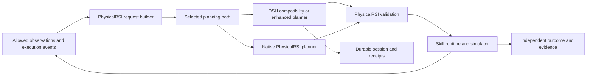
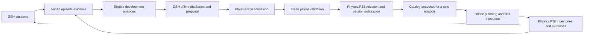

# Agent Note: DSH 与 PhysicalRSI 具身 Harness 融合及评测方案

Status: proposed

[English](2026-10-20-physicalrsi-phase-one-integration.md) | 中文

## 问题

本次改造的交付目标是：基础任务的原生成功率追平 PhysicalRSI，耗时与成本增量受控；在已有感知和动作能力覆盖的复杂任务及可恢复扰动中，成功率明显优于原生 PhysicalRSI。接通模型、保存会话或单次仿真成功均不能单独满足该目标。收益必须由冻结条件下的对照实验支持，不能提前承诺。

PhysicalRSI 已有运行时规划和开发阶段 System 2。DSH 提供模型调用、持久会话及上下文管理；新增收益需要来自执行反馈实际改变后续计划、异常恢复和跨子任务记忆。仅替换模型调用无法证明这些收益；盲目增加推理也可能降低成功率或增加延迟。

## 提案

保留 PhysicalRSI 的观测过滤、领域规则、skill 执行、物理状态和任务判定职责，通过公共 Python SDK 接入 DSH。建立独立的兼容路径与增强路径：兼容路径保持原生行为用于非劣验证；增强路径在领域事件触发时调用 DSH 重规划，由 PhysicalRSI 校验并执行。

本次交付必须完成阶段一的兼容对照和阶段二的在线重规划、异常恢复及效果验收。阶段零冻结基线与评测协议；阶段三离线沉淀 skill 可以并行准备，但不作为获得在线收益的前提。简单任务沿用既有执行路径，没有领域触发时不增加规划调用。

实现已部分完成，效果验收仍待进行。兼容集成已有 macOS 和 Linux 协议证据；单环境在线 runner 已有真实仿真证据，冻结后的配对实验仍须单独验收。首个联调目标是 `general_pickup`、`arx_x5`、单环境和现有 code-policy；完整验收必须覆盖下述基础、长程组合和可恢复扰动任务集。未验证的策略、机器人和任务范围不能纳入结论。

[开发验收记录](../../../../python/embodied/evaluations/2026-10-21-acceptance/report.zh.md)保留十二次三组 pickup episode、十三次真实请求，包括无效规划与基础设施故障。单列视觉诊断中 N/H0 失败而 H1 恢复完成；停滞 case 则各组均成功，H1 增加开销。正式效果验收仍属证据不足：保留集矩阵尚未运行，更广策略路由及长程执行未确认可用，目标移动/抓取失败覆盖缺失。上述开发结果不能完成 T7/T14 或 A1–A11 验收清单。

[固定输入 Thinking 诊断](../../../../python/embodied/evaluations/2026-10-21-thinking/report.zh.md)保留两个独立分配开发批次的 360 次请求。Thinking 提高了原生格式计划准入率，但在这些样本中未改善已有约束的在线提示词；较小输出上限可能截断推理，历史 RGB 缺失事实可能被误当成当前状态。独立的原始/澄清提示词对照支持明确当前观测状态和事件时间。这是规划器证据，不是物理任务成功验收。原生 checkpoint 加载还需依赖确认，目录存在并不足够。模型配置、提示词修改和 Harness 恢复必须作为不同实验因素。

### 实现检查点：2026-10-21

实验性[规划 bundle](../../../../packages/experimental/embodied-planner/README.zh.md) 和 [Python 适配器](../../../../python/embodied/README.zh.md) 实现了无工具 JSON 规划、有序原始图像传递、整轮截止时间、兼容模式新 Session、reset generation 拒绝、运行时轮换，以及不可覆盖的请求、事件和终态回执。可移植补丁使 PhysicalRSI 的 API 与 DSH 后端共享请求构造和校验，并在规划前分配 episode 标识。本地 PhysicalRSI 改动限于规划器、skill-model 生命周期及受影响的测试夹具，保留其已有工作区改动。

通过公共 Python SDK 运行构建后的 profile 回放，比较精确的原生系统与用户文本、有序 PNG 字节、JSON 响应模式、temperature 和输出上限，并在关闭后检查持久化 Session 日志。先前 macOS/Linux 协议冒烟以原生/H0 成对方式使用四次真实 DeepSeek 调用，输入为合成数据，未执行机器人动作。下述六次调用的开发批次接续这四次调用；协议冒烟不计为任务成功样本。

在线 runner 现已管理同步 RoboDojo 动作检查点：禁止派发、丢弃 runner 尾部、确认原生插值队列为空、回收旧代码策略工作进程，再获取新的 RGB 与本体感知后才替换计划。这是已完成动作之间的仿真静默，不代表真机运动停止。模型明确选择 bind、restart、switch 或 abort；restart 根据当前传感器重新创建原生技能，不重置场景。绑定受到可观测前置条件约束，包括 pickup 开发配置中的夹爪张开要求。说明文字和历史计划不决定执行摘要。

初始规划与恢复请求共用持久化 DSH Session，并受显式修订次数、事件次数、上下文和截止时间约束。检测器支持 RGB 缺失、指令变化和关节收到运动命令却未移动；尚未实现抓取失败及目标位姿估计。不可覆盖的 runner 记录关联停止确认、观测序列、计划提交、请求回执、原生绑定、动作版本和原生结果。首轮六次调用的开发批次使用独立保守账本；录制模型的仿真运行使用其他账本。

运动停滞检测要求部署定义的观测和命令前置条件成立：pickup 配置排除正常闭合夹爪接触，并记录关节运动量与误差测量。增强提示词保留一致的字段声明和按阶段定义的 JSON Schema；operation 是已注册的 ID 字符串，不能是附带自行构造参数的对象。显式 DeepSeek 推理控制复用 DSH 现有配置；不提供设置时保留 provider 默认行为，不代表关闭思考。对照的各实验组必须固定相同设置。

开发机以一个 `general_pickup` case、`arx_x5`、固定代码策略目录和受控扰动完成下述真实 LLM 尝试。每个成功 episode 的初始规划与一次恢复共用一个持久化 Session；核对程序关联请求摘要、停止确认、新观测、原生绑定、动作版本与原生成绩文件。

| 运行 | 真实调用 | 原生结果 | 动作数 | 证据范围 |
| --- | --- | --- | --- | --- |
| `online-live-stall-01` | 2 | 成功，成绩 100 | 114 | 四次命令保持；一次停止、重规划和重绑定；provider 默认推理。 |
| `online-live-vision-01` | 1 | 执行前规划失败 | 0 | 输出达到配置上限后截断，未产生可执行计划。 |
| `online-live-combined-01` | 1 | 执行前规划失败 | 0 | operation 对象被拒绝，未注入运行时参数。 |
| `online-live-vision-02` | 2 | 成功，成绩 100 | 113 | 一次 RGB 观测缺失；重规划前重新采集；显式关闭思考并提供类型 schema。 |

六次调用均保留在共享不可覆盖账本中，包含两次失败请求。额度耗尽后，第七次预留被拒绝，未调用模型。开发机保留每轮源码与回执，以及 `dsh-physicalrsi-dev/artifacts/online-verification.json`；所拥有的进程均已回收，已审查的原始 PhysicalRSI 源码摘要未变。先前记录响应的运行暴露了图形库缺失、原生冷启动超过 120 秒和闭合夹爪误触发；私有运行库、独立技能/RPC 预算和观测命令前置条件分别处理这些问题。记录响应的恢复冒烟也以 114 个动作获得原生成绩 100，仅作为链路证据。

本地 Python SDK/适配器检查为 275 项通过、9 项跳过；Linux 适配器检查为 38 项通过。无密钥回放覆盖同一 Session 的三轮图像输入及实际 `thinking.type=disabled` 序列化。文档门禁为 42 项通过，另有一项既存仓库引用检查失败，位于 `python/sdk/uv.lock:113`；该锁文件未修改。

T8–T12 已有单环境同步代码策略工作进程的有限实现与仿真证据。这些开发变体不合并为成功率或延迟对照。同一 episode 内多次异常的真实模型恢复、多子目标编排、检查点模型工作进程、更丰富的领域检测、pilot 功效分析和正式 G1–G4 配对验收仍待完成。三轮历史由记录响应验证，不代表真实模型多异常 episode 已成功。离线 skill 开发仍属于第三阶段。达到结果标准前，文档保持 proposed 状态。

### 设计依据与融合优势

以下局限针对本次检查的 PhysicalRSI RoboDojo 实现，不代表整个框架缺少 LLM 或所有 skill 缺少闭环。固定 planner 的远端实验属于受控设置，不能据此推断 PhysicalRSI 的整体能力。实施时以 T0 冻结的源码和能力清单为准。

PhysicalRSI 已具备可加载的策略与组合、动作分片执行、物理轨迹、记忆快照及独立环境评分；开发阶段 System 2 还提供候选准入、独立验证、选择与谱系。DSH 的价值在于复用模型提供方、持久会话、上下文管理和可扩展的 agent loop，承载任务执行期间的持续决策。保留这些已有能力，可以集中实现领域事件、计划修订与执行协调，减少重复建设。

| 当前实现或能力边界 | 对任务的影响 | 融合机制与保留的优势 |
|---|---|---|
| `skill_model.py` 在 episode 开始选择完整能力，绑定持续到 reset。 | 绑定稳定，便于复现；skill 内部可以继续闭环控制，但超出其内置恢复范围时，这条路线缺少切换高层策略的机制。 | 保留稳定执行；DSH 在领域事件后提出修订，PhysicalRSI 确认停止、刷新观测并校验后，才切换同目录内的能力。 |
| `AgentLoop.prepare()` 记录 subgoal 建议，但将原始观测交回策略。 | 增加规划调用次数本身，不保证建议改变实际动作。 | 引入可校验、可提交的计划修订，将子目标与能力选择关联到执行，并验证修订确实改变后续行为。 |
| 已有记忆快照、视觉历史和执行记录；任务 planner 使用显式 memory/previous_plan 输入。 | 这些能力有助于物理执行，但还需连接跨子任务的模型会话与上下文管理。 | DSH 保存决策历史、失败尝试和模型调用；PhysicalRSI 提供权威当前状态，避免从摘要猜测位置、绑定或活动动作。 |
| 开发阶段 System 2 根据受控 development 反馈生成并评估候选，尚无任意 DSH 历史会话导入器。 | 可以改进后续 skill 版本；当前 episode 的异常恢复和通用历史经验导入仍需新增适配。 | 在线恢复与离线开发分开实施；DSH 提炼经验和提出候选，PhysicalRSI 保留证据校验、独立评估、选择及发布权限。 |
| 可观测状态、已有动作和可停止能力均有明确范围。 | 缺少必要 skill、观测或可靠停止能力时，更长的推理不能直接补齐物理能力。 | 先检查能力覆盖；在线明确停止或报告不足，离线尝试开发候选并验证。新增感知模型、策略权重或机器人能力另行建设。 |

上述判断的核查入口是 PhysicalRSI 仓库中的 `PhysicalRSI_baselines/robodojo/skill_model.py` 的 `_start_episode()`、`agent_planner.py` 的 `AgentLoop.prepare()`、`proposal.py` 的 `CodeProposer.propose()`，以及 `PhysicalRSI_core/self_harness`。这些入口分别对应执行绑定、规划建议、候选生成和独立选择流程。

三种循环使用不同的触发方式，以兼顾基础任务开销、复杂任务适应和长期改进：

| 循环 | 职责组合 | 设计收益 |
|---|---|---|
| 高频执行 | PhysicalRSI 处理观测、控制与动作分片。 | 沿用已有执行路径，正常推进时不新增 LLM 调用。 |
| 低频在线规划 | DSH 维护上下文并提出有界计划；PhysicalRSI 提供事件、状态、停止确认、校验与执行。 | 在子任务完成或异常时调整后续行为，同时保留物理状态和任务成功的独立判定。 |
| 离线能力开发 | DSH 关联历史证据、提炼和提出候选；PhysicalRSI 的开发流程评估、选择并发布版本。 | 将有效经验转化为后续任务可用的能力，复用已有验证与谱系机制，不影响当前 episode。 |

例如，假设目录已有抓取、搬运和放置能力，搬运时发生物体脱落。若当前 skill 提供内置恢复，则先由它处理；需要改变高层策略时，PhysicalRSI 报告异常并确认停止，DSH 根据新观测和此前尝试修订子目标，PhysicalRSI 校验后执行。若观测无法确认物体状态，则报告未知并停止。任务结束后，这段记录可进入独立离线开发，而不是直接成为已发布 skill。

DSH 也需要具身领域适配：通用循环的完成状态不能代替环境成功，文本摘要不能充当当前物理状态，关闭模型进程也不能证明机器人停止。领域事件、停止回执、计划修订和配置档适配均是待实施工作。下文的同模型、同目录、同预算对照用于验证这些组合机制是否实现基础任务非劣与复杂任务优效。

### 远端环境评估

2026-10-20 通过只读 SSH 检查了 `/mnt/nas/qingning/projects`，以下结果清单以上海时区 17:52 为截止时点。本小节路径均相对于该远端根目录。本次评估没有启动仿真、模型推理、安装或实验。

**结论：可作为融合联调环境，并提供单任务成功执行证据；尚不能作为已经冻结、可直接复现的 DSH 对照基线。**

| 证据 | 观察到的状态 | 对方案的影响 |
|---|---|---|
| `envs/robodojo-sim`、`envs/robodojo-policy` | 均使用 Python 3.11.17。仿真环境报告 Isaac Sim 5.1.0.0 和 Torch 2.7.0+cu128；两个环境的 WebSockets 版本不同。 | 保留两个解释器及其依赖记录，不合并环境。 |
| GPU 清单 | NVIDIA RTX PRO 5000 72GB Blackwell，驱动 580.126.09。 | 可复用现有仿真主机；实验前仍需重新检查资源可用性。 |
| `results/general-pickup/20261019-172643/client.log` 与原生结果 | 日志记录 110 步和一次成功。原生 `_result.json` 记录 `eval_time=1`、`success_rate=1.0` 和 layout 0 成功。存在三个视频文件。 | 确实完成过单任务 code-policy 执行，不能据此声明全 benchmark 成功率。 |
| `results/general-pickup/policy/0c2c331c29cd4d579f2ad2884f2bbd3b/episodes/c5fa8486337442248cb0a8344d8b7115/` | 决策、绑定、执行记录选择了 `instruction-grounded-pickup`；执行记录为 110 个已交付动作分片。 | 可复用这些记录与 skill 集成；完整模型调用标识及其与仿真运行的关联仍需统一回执。 |
| `results/general-pickup/20261019-172419/` | 进程退出码为 0，但客户端报告 `ModuleNotFoundError: PhysicalRSI_baselines`，没有完成试验。 | 退出码不能单独作为验收证据。 |
| `results/system2-pickup/` | 六份完整 episode 记录具有原生成功结果、自然终止、退出码 0、无 observer 失败记录，且每份都有三个非空视频。原生结果的字节哈希及布局的规范化哈希与回执一致。 | 可作为受控执行证据；脚本刻意固定了 planner 并扰动布局。 |
| `setup/codex-bridge/smoke-result.json` | 合成图像的远端到本地 Codex 响应，明确标记 `qualification=false`。 | 仅证明传输链路，不属于机器人任务结果。 |
| `results/report-finalizer-selftest/` | 包含看似成功的报告及复制的结果材料。 | 报告自测不计入实验数量。 |
| `physicalrsi-assets/skill-assets/` | 存在 code skill、OpenPI 和两类 `pi05` 检查点目录树。已有 pickup 资产检查报告记录 382 个文件。 | 资产可供检查；当前完整性、学习型模型加载和学习型策略执行均未重新验证。 |

10 月 19 日成功运行的原生结果位于 `RoboDojo/eval_result/RoboDojo/general_pickup/physicalRSICodex/arx_x5/0_code-first-smoke/2026-10-19_17-26-46/_result.json`，同目录包含三个相机视频。本次评估核查了文件存在性和记录指标，未观看视频内容。

受控实验具有以下观测。每行代表一个 episode，两组 validation 配对分别具有相同的规范化布局哈希。

| `results/system2-pickup/` 下的运行目录 | Episode | Settle 动作数 | 已交付动作数 | 原生成功 |
|---|---|---|---|---|
| `system2-pickup-20261020-171542` | `development-parent` | 60 | 110 | true |
| `system2-pickup-20261020-171949` | `validation-parent` | 60 | 110 | true |
| `system2-pickup-20261020-171949` | `validation-candidate` | 54 | 104 | true |
| `system2-pickup-next-20261020-174441` | `development-zero` | 0 | 50 | true |
| `system2-pickup-next-20261020-174441` | `validation-parent` | 54 | 104 | true |
| `system2-pickup-next-20261020-174441` | `validation-candidate` | 0 | 50 | true |

`setup/system2/remote_episode.py` 和 `remote_episode_next.py` 第 8–15 行均将 `skill_model.AgentPlanner` 替换为固定答案。它们还选择显式扰动布局，并创建修改阶段动作预算的 skill 覆盖副本。后一个脚本增加了特权物理诊断。这些观测支持受控执行成功及这些 episode 中动作数减少的结论，不能证明 LLM 规划收益、泛化能力或完整的提案—评估—选择—继承循环。特权诊断必须仅用于评测。

当前远端 `agent_planner.py` 已支持 `api`、`codex` 和 `remote-codex`；本地 `/Users/rockops/codes/PhysicalRSI` 缺少远端 Codex 后端文件，planner 内容也不同。远端 PhysicalRSI 目录没有 `.git`；RoboDojo 存在未跟踪的 XPolicyLab 策略适配器，IsaacLab 的 `setup.py` 也有修改。选定实施基线前，应先核对并保留这些差异。

| 抽查文件 | 检查时观察到的 SHA-256 |
|---|---|
| 远端 `PhysicalRSI/PhysicalRSI_baselines/robodojo/agent_planner.py` | `fd3ac5afe8c7b895550810222aca6c305c5192de63dd8f99376ca4d2c9c83557` |
| 本地 `PhysicalRSI_baselines/robodojo/agent_planner.py` | `d6f6936d5b57283c7c8affacd857356f9b1e8f8d5f54a7b6959a4e70c1cb25db` |
| 两份副本相同的 `PhysicalRSI_baselines/robodojo/skill_model.py` | `a9a965538b15198df7b5a9521d45af92a205ead1ceba7bca659efabbe4aba9e5` |
| 远端 `setup/system2/remote_episode_next.py` | `854e2aa751fcaaf35548624591e1222c1d1ec63fe85a64fa1d766a3be6cc1982` |

Pickup 配置选择回环端口 18765 上的 `remote-codex`。连通性检查时，该端口和策略端口 9999 均未接受连接；这是单个时点的观测，不是服务故障诊断。SSH shell 的 PATH 中未发现 `node`、`pnpm` 或 `dsh` 可执行程序。因此，融合运行前需要准备固定版本的 DSH 运行时和可访问的模型路由，不能假设此前的 Mac 到服务器桥接仍然可用。

### 阶段与完成条件

阶段一是集成里程碑，阶段二通过才满足本次改造的效果目标。每阶段都有独立配置和产物，增强行为不能污染兼容对照。

| 阶段 | 交付内容 | 完成条件 |
|---|---|---|
| 零：冻结原生基线与协议 | 核对源码、资产、最强可用原生配置、能力覆盖、任务分区及资源预算，使用开发预实验确定样本量。 | T0 完成；正式评测前冻结指标、阈值、case 清单、统计方法和停止规则。 |
| 一：兼容融合与基础追平 | DSH 规划后端、公共 SDK 桥接、输入等价、生命周期、执行证据；保留 reset 前固定绑定。 | T1–T7 完成，兼容路径满足 G1/G2/G4；单次 pickup 成功只算冒烟。 |
| 二：在线重规划与异常恢复 | 领域事件、可停止执行、跨子任务上下文、有界修订计划和已验证 skill 切换。 | T8–T15 完成；最终增强路径同时满足 G1–G4，基础任务不得被复杂任务收益掩盖。 |
| 三：离线 skill 沉淀 | 历史 development 数据导入、DSH 提炼/提案、PhysicalRSI 评估/发布、新 episode 消费。 | F1–F4 独立验收；固定目录下的在线收益须先单独报告。 |

### 模块职责

复用 PhysicalRSI 的控制器与评测机制。DSH 通过实验性组合及已有扩展点承载规划，不将物理动作或环境真值搬进通用 agent loop。

| 归属 | 职责 | 阶段约束 |
|---|---|---|
| PhysicalRSI 请求构造器 | 过滤观测，构造领域提示词、记忆、目录及有序图像。 | 阶段一所有后端输入等价；阶段二增加可观测状态和事件，不暴露隐藏评测标识。 |
| PhysicalRSI 计划校验器 | 校验模式、注册操作、组合、单位/坐标系和前置条件。 | 阶段一保留已有规则；阶段二校验计划修订、停止回执、状态新鲜度与剩余预算。 |
| Python DSH 桥接器 | SDK 生命周期、关联标识、截止时间、结果提取、跨系统回执。 | 每运行时一个进行中的请求；模型重试不重放动作；关闭 DSH 进程不等于停止机器人。 |
| DSH `embodied-planner` 组合 | 模型路由、持久多模态会话、有界规划及上下文管理。 | 兼容配置无工具和自动摘要；增强配置保留 episode 内历史，只返回领域计划，不生成在线执行代码。 |
| DSH 模型提供方 | 序列化生成参数与多模态输入，报告响应、用量和失败。 | 核查真实出站请求；不支持的能力提前失败；模型调用与规划循环共享总预算。 |
| PhysicalRSI observer | 从允许运行时使用的观测生成进度、失败和状态变化事件。 | 阶段二增加事件去重、触发规则及证据引用；评测器的扰动标签和隐藏状态不作为触发输入。 |
| PhysicalRSI skill 运行时 | 绑定版本、执行动作分片、停止/清理、刷新状态、检查切换条件。 | 阶段二仅在确认停止后切换同一目录快照内的能力；不能安全中止的 skill 不进入可中断恢复路线。 |
| RoboDojo/独立环境评测器 | 环境推进、最终成功、终止、约束违规及独立评分。 | 模型完成、子任务完成和最终任务成功分别记录；评测真值与在线模型输入分离。 |
| PhysicalRSI 开发阶段 System 2 | 候选准入、评估、选择、版本发布及谱系。 | 阶段三接入 DSH 离线提案；在线任务不等待新 skill 生成。 |

下图展示两条规划路径共用的领域执行关系；兼容路径只在原有规划机会触发，增强路径增加执行反馈触发。

DSH 的 [plan-mode](../../../../packages/plan/plan-mode/README.zh.md) 面向人工规划评审；[goal-round-driver](../../../../packages/goal/goal-round-driver/README.zh.md) 负责继续执行，不验证物理成功。领域规划循环由专用组合与 PhysicalRSI 协调器接入已有扩展点，默认不改核心循环；若必须改动，另行评审并更新架构及两种 SDK 的预期输出。

### 接口设计

以下是拟新增的应用层记录，不是新增 SDK RPC 方法。标识符在 TypeScript 侧使用品牌类型。在实际解析器中校验模型 JSON、配置、文件和进程消息；不在已有类型保证的同进程调用中重复增加运行时校验。

| 记录 | 必要信息 | 归属与规则 |
|---|---|---|
| `PlanningContext` | `runId`、预分配的 `episodeId`、`envIdx`、`resetGeneration`、`requestId`、单调时钟截止时间。 | PhysicalRSI/桥接器元数据，不自动加入模型内容。 |
| `PreparedPlanningRequest` | `schemaVersion`、`requestId`、`mode`、`systemPrompt`、有序 `userContent`、领域输出 schema、`inputDigest`。 | 由 PhysicalRSI 构造，准备完成后不可变。 |
| 图像块 | MIME 类型、原始尺寸、内容摘要、字节或可解析的附件引用、有序位置。 | 保留相机顺序和图像与 JSON 的索引关系；提交前附件数据必须可用。 |
| `PlanningCompletion` | `requestId`、`inputDigest`、原始响应文本、终态、可获得的提供方结束原因、会话引用、用量、耗时。 | 由 DSH 桥接器生成；缺失用量为未知，不是零。RPC 入队完成不代表规划完成。 |
| `ValidatedPlan` | 已有模式对应的字段，以及完成回执的引用。 | 由 PhysicalRSI 校验器生成，领域结果返回当前消费方。 |
| `PlanningFailure` | 稳定的失败类别、请求引用、执行阶段、重试处置、结果确定性、诊断引用。 | 由下述处理归属方报告；调用方不解析错误字符串。 |

`inputDigest` 通过带版本的规范化编码，覆盖完整系统文本、有序用户文本与图像摘要、模式和输出 schema。`modelConfigDigest` 单独覆盖解析后的提供方/模型、采样、响应模式、图像策略、输出上限及超时/重试配置。同时记录实际提供方序列化结果：仅准备输入摘要相同，无法发现下游添加的提示词。

兼容路径保留当前四种模式：仅 subgoal；composition 加 rationale；composition 加 operations 加 rationale；operations 加 rationale。在适用时保留 `instruction`、过滤后的 `observation`、`task_specific_policy_memory`、`previous_plan`、`available_compositions` 和 `operation_program`。Operation library 仍要求在 episode 开始时选择一个完整能力，学习型 composition 保留已有 operation 限制。

请求构造器继续从模型内容中移除任务名别名、layout 和 seed 标识、环境索引、深度、分割、点云及私有实现元数据。评测真值和特权物理诊断不进入模型输入。该限制适用于所有后端，而非仅 DSH。

桥接器将准备、完成和资源释放作为独立生命周期操作。启动前，配置解析生成一份不可变运行规格：后端、提供方/模型路由、配置档、提示词摘要、输出模式、采样、图像限制、请求预算、运行时/会话数量限制及产物位置。凭证通过部署环境解析，不写入回执。

初始失败类别为 `configuration`、`transport`、`deadline`、`incomplete_output`、`invalid_plan`、`stale_request`、`persistence` 和 `runtime`。`terminalState` 区分 `completed`、`failed`、`cancelled` 和 `unknown`，只有 `completed` 才能进入领域校验。一个逻辑请求在有界推理重试中保留同一 `requestId`，每次尝试获得独立的 `attemptId` 并记录结果。

### 兼容路径的 DSH 组合与运行时生命周期

拟在 `packages/experimental/embodied-planner` 下建立实验性组合包 `@deepseek-ai/dsh-experimental-embodied-planner`，提供命名配置档和受支持的 SDK 服务组合。通过[统一 dsh 应用入口](../../implemented/architecture/2026-08-22-single-dsh-application-launcher.zh.md)启动。不在 PhysicalRSI 中复制启动器，也不依赖 SDK 私有 argv 钩子。

当前 [sdk-minimal 组合](../../../../packages/bundle/sdk-minimal/cordis.patch.yml)包含不适合输入等价实验的行为。应复用已有提供方和服务建立显式的最小组合，保留日志、附件持久化和生命周期管理，排除模型可见工具与自动上下文改写。

两处适配器缺口需要显式实现并测试。[GenerateOptions](../../../../packages/llm/llm/src/types.ts) 当前没有通用 `response_format` 字段，而已有 API planner 请求 JSON-object 输出。[pi-ai 上下文转换](../../../../packages/llm/llm-pi-ai/src/context.ts)会插入图像句柄文本，请求准备也可能变换图像。应增加复现选定基线所需的最小、带类型且经校验的配置，包括专用配置档的内联图像呈现方式。其他配置档保留原有默认值。不受支持的模型能力必须在 episode 绑定前失败。

每组冻结的提示词/模式/模型配置复用一个长生命周期 SDK 运行时，每次规划创建新 Session。`previous_plan` 只通过已有显式输入传递。领域提示词变化时选择另一份运行规格，不能修改其他请求的系统提示词。使用专用 Harness home，并在空闲时按照可配置的会话数量上限轮换运行时。

规划前分配 episode 标识，在绑定与产物中复用。仅当请求 ID、输入摘要和 reset 代次均匹配，响应完整且未截断，并通过领域校验时才接受结果。绑定 skill 前提交回执。Reset 使待完成请求失效；迟到响应不能绑定到已复用的环境索引。

[Python Session.run 实现](../../../../python/sdk/src/deepseek_harness/api.py)在提示词提交后持续等待通知，其 RPC 超时不是规划总时限。[当前 SDK 协议](../../../../packages/sdk/protocol/src/types.ts)提供 `session/wait`，但没有单会话取消或释放方法。因此，桥接器必须独立管理总时限；超时后关闭其单请求运行时，等待进程终止后才能复用。不能声称这会取消外部模型提供方已经接受的工作或计费。

| 失败 | 处理归属 | 必须得到的结果 |
|---|---|---|
| 配置无效、配置档缺失、不支持图像/JSON 模式 | 桥接器/提供方启动阶段 | 就绪检查失败并提供可操作诊断，不绑定 skill。 |
| 传输中断或提供方失败 | DSH 推理策略 | 只有显式可重试的推理失败才能在共同次数/时间预算内重试，记录每次尝试；Python 不增加第二层重试循环。 |
| 空响应、截断、JSON 无效或领域计划无效 | 桥接器/PhysicalRSI 校验器 | 记录失败并停止本次规划，不修复或回退。 |
| 超时、reset 竞争、运行时崩溃 | 桥接器 | 使待完成请求失效，停止并等待所管理的运行时，保留不完整证据，拒绝迟到结果。 |
| 会话或回执持久化失败 | DSH/桥接器产物管理方 | 停止后续绑定，通过独立诊断路径报告失败。 |
| Skill 执行或仿真失败 | PhysicalRSI/RoboDojo | 保留原生失败或未知结果，不改写为 planner 成功。 |

共同解析尝试次数、单次尝试超时、规划总时限、清理时限和外层策略超时。远端 pickup 启动器当前设置 planner 传输超时 210 秒、策略请求超时 240 秒，受控脚本使用 300 秒。这些是检查到的设置，不是拟定的通用默认值。启动/预加载耗时单独核算；就绪运行时的完整规划预算必须落在外层超时之内。第一阶段的重试不得重放物理动作。

总时限包括请求准备、排队、附件持久化、RPC 和推理。崩溃或超时后，检查未完成 Session 不得自动恢复模型生成或执行。后续尝试必须作为显式新请求启动，并保留此前未知结果的可见性。

回执关联 run、episode、request、reset 代次、Session、准备输入、解析后的模型配置、源码/构建标识、skill/记忆版本、响应、错误、尝试次数、耗时及原生结果引用。DSH 负责可重建的模型输入输出，PhysicalRSI 负责绑定与执行事实。优先复用已有 Session 事件并增加外部回执，不为关联信息本身修改持久 Session 格式。

### 增强路径：在线重规划与异常恢复

阶段二使用与兼容路径隔离的命名配置。每个 episode 固定目录和代码/记忆版本，允许在已验证能力之间切换；不改变运行中的 skill 实现。DSH 管理 episode 内的决策历史和有界模型调用，PhysicalRSI 协调器串行提交计划修订、调度执行并维护物理状态。这是新增应用层协议，现有 worker 的 reset/close 不能直接视为已实现安全停止。

| 新增记录 | 必要信息 | 接受条件与归属 |
|---|---|---|
| `ExecutionEvent` | event/episode/execution 标识、reset 代次、当前计划版本、观测序号/时间、事件类别、证据引用。 | PhysicalRSI 从可用观测报告子任务完成、抓取失败、目标丢失、进展停滞或前置条件失效；去重后交给规划器，不透传注入脚本标签。 |
| `RuntimeState` | 当前物理状态及未知项、状态版本、观测时间、当前绑定、已完成子任务、活动动作、剩余预算。 | PhysicalRSI 持有权威记录；模型只能读取允许字段，不能凭摘要修改状态或宣告完成。 |
| `StopReceipt` | stop/execution 标识、请求/确认时间、停止结果、清理结果及刷新观测引用。 | PhysicalRSI 确认旧执行已停、没有在途动作且排队动作已完成或撤销；超时或结果未知均不授权替代计划的动作，DSH 进程退出不是替代证据。 |
| `PlanRevision` | request/episode 标识、父计划版本、状态版本、目录版本、下一子目标、选定能力/参数、前置条件、退出条件及预算。 | PhysicalRSI 仅在父版本、reset 代次、停止回执和新鲜状态匹配时提交一次；模型给出合法 JSON 仍须通过领域校验。 |

执行状态按“运行 → 触发 → 停止确认 → 新观测 → 规划 → 校验 → 提交/执行”转换。子任务自然结束也必须确认没有活动动作。停止请求发出后禁止提交旧计划的后续动作分片；已发出的动作由运行时按声明的停止保证处理。新观测若在规划期间失效，则拒绝该修订并在剩余预算内重新观测；不得执行陈旧计划。

| 情况 | 处理策略 | 终止条件 |
|---|---|---|
| 正常推进、无事件 | 继续现有 skill，不调用额外模型。 | 原生最终成功或预算结束；子任务完成可以触发下一步。 |
| 可恢复物理异常 | 确认停止、重新观测，在现有目录内选择重试、替代能力或子任务调整。 | 恢复次数、同类失败或无进展预算用尽后停止，保留失败原因。 |
| 格式/语义无效计划 | 保持停止状态，允许配置限定次数的计划修订，记录被拒响应及校验反馈。 | 仍无有效计划或规划预算用尽即失败，不静默换后端或执行未校验内容。 |
| 提供方失败、超时、日志失败 | 沿用有界推理及持久化失败规则；PhysicalRSI 独立处理执行停止。 | 未确认停止、证据不可持久化或状态未知时结束为失败/未知，不自动重放动作。 |
| 缺少能力、观测无法判断、硬约束触发 | 报告能力不足或状态不确定，停止相关执行。 | 不在线生成新代码、不猜测状态、不把停止报告为任务成功。 |

触发防抖、事件优先级、观测有效期、停止时限、每次调用预算、episode 总推理预算、最大修订/恢复次数和无进展上限都在运行规格中显式配置，正式评测前冻结。提供方传输重试、计划修订和物理恢复分别计数，共享 episode 时间/费用上限；不得嵌套成无界重试。相同事件只处理一次，新的 reset 代次使旧事件和响应失效。

增强路径在一个 episode 内保留多轮 Session 历史，episode 之间隔离。每次调用仍只有一个进行中的请求；超时关闭所管理的 DSH 运行时，同时由 PhysicalRSI 保持停止并结束该 episode。已结束或未知会话不会自动恢复执行。上下文只包含原始可用观测、已校验计划、执行回执及其可追溯摘要；机器人状态和活动动作始终来自 `RuntimeState`。达到上下文预算时必须执行经记录与验证的压缩策略或明确停止，禁止静默丢弃状态。自动压缩不是首轮在线收益的前提，启用时增加对应消融实验。

最小实现覆盖一个至少三步且存在依赖的组合任务，以及至少一种可恢复扰动，验证计划变化确实改变后续动作。完整阶段二验收必须覆盖评测集定义的全部必测类别；仅记录建议、预设恢复脚本或固定答案不能充当 DSH 在线闭环的证据。

### 从历史执行会话沉淀 skill

历史会话提供决策过程，物理轨迹提供执行事实，两者需要关联才能支持可检验的经验提炼。这里的 skill 指 PhysicalRSI 可加载的策略、组合或策略记忆，不等同于 DSH 的 `SKILL.md`。将一次成功会话总结成文本，不代表已经获得可复用的机器人能力。

当前 PhysicalRSI 已有部分链路：`PhysicalRSI_baselines/robodojo/proposal.py` 的 `CodeProposer` 使用已有代码、记忆、development 反馈和 primitive API 提出候选；`skill_proposal.py` 保存并校验提案；`workflow.py` 与 `PhysicalRSI_core/self_harness` 组织准入、独立验证、选择及谱系提交。它们消费受控开发流程产生的反馈，尚未提供任意 DSH 历史会话的导入器。拟新增的工作是证据关联、开发数据适配及 DSH 提案提供方，复用 PhysicalRSI 的评估流程。离线提炼可以调用 LLM，不等同于已有无 API 的 `OfflineProposer` 模板模式。

| 环节 | DSH 负责 | PhysicalRSI 负责 |
|---|---|---|
| 执行证据 | 保存模型可见输入、响应、会话事件和附件；提供可解析引用。 | 保存观测、动作分片、时间/步骤顺序、绑定、原生结果以及机器人、环境、skill/记忆版本；桥接器关联双方记录。 |
| 经验提炼 | 从已结束且证据可用的开发 episode 提炼失败模式、有效策略、适用条件和反例；每项结论引用原始证据。 | 校验记录完整性、数据分区和物理语义，提供允许进入模型的开发反馈，排除不兼容或无法解释的轨迹。 |
| 候选生成 | 以独立离线作业管理上下文、模型调用、预算与重试，提出参数化代码、组合或记忆候选。 | 提供 primitive API、父 skill、可用操作、单位/坐标系和运行限制；将候选适配到现有提案格式。 |
| 候选评估 | 保存生成会话并解释开发反馈；不自行宣布候选合格。 | 校验代码、依赖和运行接口，在隔离环境执行，并通过独立验证集与父版本配对评估。 |
| 发布与检索 | 按已发布引用读取或检索目录投影，为后续规划提供相关候选。 | 独占选择、版本发布和谱系提交权限；维护能力目录、适用范围和验证结果，控制在线可见性。 |

#### 证据与交接记录

以下名称表示拟定的应用层交接记录，不要求新增 SDK RPC 或复制 PhysicalRSI 已有提案/评测格式。第一阶段只实现 `EpisodeEvidence` 的关联清单及导出；其余记录在后续适配时映射到已有格式。

| 记录 | 必要信息 | 处理规则 |
|---|---|---|
| `EpisodeEvidence` | schema 版本；run/episode/request/Session 引用及事件范围；计划与绑定；观测、动作和原生结果的带摘要产物引用；机器人、环境、skill/记忆及配置标识；步骤顺序；数据分区与采集方式；结束原因和完整性状态。 | 桥接器汇总双方证据；成功、失败、中断和未知结果分别保留。标识符可关联不代表产物完整，也不代表任务成功。 |
| `ExperienceProposal` | 来源 episode 与证据片段、问题描述、适用条件、参数、反例、拟改变的行为、提案会话和开发数据清单。 | DSH 生成可追溯的候选经验；单次轨迹中的相关性只作为待验证假设，不能直接扩大适用范围。 |
| `SkillCandidate` | 父版本、代码/组合/记忆及摘要、依赖、primitive API、输入输出、单位/坐标系、前置条件、终止与失败退出条件。 | PhysicalRSI 适配并准入；语法或接口校验通过不代表物理任务表现合格，候选不能进入在线目录。 |
| `SkillRelease` | 不可变 skill/记忆版本、候选与父版本引用、验证协议/结果、适用范围、选择决定和谱系提交记录。 | PhysicalRSI 发布；DSH 只消费投影。父版本变动导致提交冲突时停止发布并重新评估，回退保留新的选择记录。 |

第一阶段保留已有结构化物理轨迹，并记录采样策略及缺失片段，不要求把所有帧复制进 Session。桥接器在结束或中断时封存关联清单，检查摘要和引用可用性。缺失轨迹、损坏附件、来源不明或结果未知的记录可以用于诊断，但不能冒充完整训练样本或成功示范。失败 episode 在证据完整时是有效开发反馈，不应因失败而被删除。

后续导入器只接受明确分配给 development 的历史数据，并保留原始分区；validation/test 及其隐藏答案不能重新标成 development 输入给提案模型。跨分区重复场景/轨迹由 PhysicalRSI 检查，分区不明时隔离处理。独立验证在候选和比较集合冻结后进行，保留未见场景；验证失败的候选仍保留记录，但不发布，也不把保留集细节送回提案循环反复调优。

#### 离线开发与在线规划的协作

在线路径固定 PhysicalRSI 已发布目录的快照；离线提炼消费已结束且分区合规的执行记录。两个流程使用独立作业、模型预算与产物目录。离线失败不影响当前执行，新发布版本仅在新 episode 加载；DSH 检索必须回到 PhysicalRSI 目录解析，不能维护另一套发布状态。

阶段二使用固定 skill 库验证在线收益，阶段三再加入离线生成能力。需要目录外的新能力时，在线路径明确报告不足，由后续独立开发作业处理。阶段三同时比较原生和增强规划器消费同一改进目录的结果，并给予原生 PhysicalRSI 自身开发循环相同的开发数据和预算，区分目录改进、规划改进和二者组合的贡献。

### 对照实验与验收指标

效果验收使用真实模型和独立环境结果。下述阈值是本提案的工程验收目标，不是已取得的结果；T0 将任务范围、预算数值和统计方案冻结到协议。正式保留集揭盲后不得放宽阈值、删除困难任务或增加样本直到通过；设计变更必须登记新实验并使用新的保留集。

#### 对照组与公平条件

| 组别 | 配置 | 用途 |
|---|---|---|
| B0：固定计划 | 已知计划与现有 skill 执行。 | 执行冒烟；不参加“追平/优于原生”计算。 |
| N：原生 PhysicalRSI | T0 在开发集选择并冻结的最强可用原生配置，保留其支持的规划、记忆和恢复能力，正常调用模型。 | 主要对照；禁止用关闭已有能力或固定 planner 的简化版本替代。 |
| H0：DSH 兼容路径 | 与 N 相同的模型、输入、skill 库、规划机会和执行语义，仅替换调用及证据管理。 | 阶段一验证调用等价、基础非劣和开销；隔离 Harness 接入影响。 |
| H1：DSH 在线增强 | 固定与 N/H0 相同的 skill 库，增加事件触发、上下文历史、重规划和恢复。 | 阶段二的交付版本；在基础集对 N 复验非劣，在复杂集验证优效。 |
| H1-R / H1-M | 分别关闭异常重规划，或仅保留当前观测与必要物理状态、不使用跨子任务决策历史；其他配置保持一致。 | 消融实验；测量恢复与历史贡献，不将普通规则脚本的收益全部归因于 LLM。 |
| H2：离线扩展 | H1 加上阶段三独立验证后的 skill 目录；另运行 N 消费相同目录及原生开发循环的预算匹配对照。 | 后续分离在线规划、目录改进和离线开发方法的收益，不替代 H1 固定目录验收。 |

N 的源码副本、未提交修改、依赖、模型端点和实际参数必须可解析。“最强可用”仅指在预先约定开发范围内选择的配置，不宣称覆盖所有 PhysicalRSI 版本。若已有原生服务使用不同模型，保留为额外运行参考，并另建同模型 N；不能用模型升级证明 Harness 收益。缺少原生所需依赖时先恢复依赖或缩小并明确双方支持范围，不削弱基线后继续宣称完整超越。

所有正式组使用相同机器人、控制频率、策略权重、skill/记忆初始版本、允许的传感输入、任务说明、资产与硬件资源上限。H0 的模型请求逐项等价；H1 的历史和事件输入是实验变量，必须可重建。H1 在 S/L/U 使用同一冻结在线策略，任务集标签不进入路由器，不能为基础集关闭增强再为复杂集开启。各组共享每 episode 的物理步数、仿真时长、端到端墙钟时限、总模型费用/token 上限及单次输出限制。相同上限不要求相同实际消耗；分别报告实际值。额外预算实验单列成本—成功率曲线，不计入固定预算优效验收。

配对 case 使用相同初始状态和扰动定义，各组独立 reset，不共享执行中状态。调用顺序随机化并交错运行，隔离资源争用，记录提供方变化；冷启动与预加载单列，正式耗时从环境和策略就绪后的任务提交开始，到原生终止或期限结束为止，包含规划等待、日志和恢复。仿真是否在规划期间暂停必须所有组一致。

#### 任务集与能力范围

| 集合 | 必测内容 | 防止失真 |
|---|---|---|
| S：基础任务 | 原生已支持的正常任务、代表性布局和全部纳入声明的 skill 路由，无人为扰动。 | 任务族等权汇总并逐族报告；不能只挑 pickup 或只挑增强后成功的运行。 |
| L：长程组合 | 至少两个任务族，每任务至少三个有先后依赖的子目标，覆盖顺序调整和已有能力的新组合。 | 冻结目录提供所需动作；开发与评测分离对象/布局/组合，不能预置评测任务的完整答案。 |
| U：可恢复扰动 | 至少覆盖目标位置改变、一次抓取失败、短暂观测遮挡/缺失三类，范围在现有可观测、可操作能力内。 | 统一预登记的外生条件或语义触发规则，不读取组别；注入标签仅供评测，在线只能从允许观测识别异常。 |
| X：能力不足/不可判定 | 缺少必要 skill、持续无观测、停止确认失败等。 | 检验明确停止和未知状态处理，单独报告；不以保守停止充当任务成功，也不混入可恢复收益。 |

RoboDojo 原生任务继续使用原生成功判定。新增长程组合或扰动扩展使用双方共用、独立于 planner 的环境判定器，并先验证判定器；结果单列为扩展测试，不能合并成官方 benchmark 分数。未到达扰动触发条件的运行仍保留在预定 case 分母中，另报实际注入覆盖率，不事后筛选“确实遇到困难”的成功样本。

#### 指标与通过门槛

成功率指在共同时间/动作/模型预算内由环境确认的最终成功。令差值为候选成功率减 N 成功率，以百分点计；按任务族等权汇总，L 和 U 分别作为必过总体。表中的置信界均为预登记配对分析的单侧 95% 界。所有 G 条件联合通过，速度或局部任务收益不能抵消成功率退化。

| 条件 | 指标与门槛 | 适用范围 |
|---|---|---|
| G1：基础成功率非劣 | S 总体及每个必测任务族的成功率差值下界均不低于 −2 个百分点。 | H0 对 N、最终 H1 对 N 分别通过；−2 是允许的非劣界限，不等于已证明完全相等。 |
| G2：基础性能开销 | S 上所有运行的截断完成耗时 p50、p95 比值上界均不超过 1.10，平均模型费用比值上界不超过 1.10。 | H0/H1 各自对 N；基线零模型调用的任务保持零新增调用，不用除零比值。 |
| G3：复杂任务明显优效 | L、U 各自的成功率差值点估计至少 +10 个百分点，且下界至少 +5 个百分点；其中每个必测任务族下界不低于 −2 个百分点。 | H1 对 N，在共同资源上限内通过两类总体；不能只赢一类或用事后加权平均掩盖退化。 |
| G4：执行正确性与证据 | 测试和正式运行中，旧执行未停止时提交替代计划动作、陈旧计划生效、重复提交、绕过领域硬约束均为零；请求、执行和最终结果可关联。 | H0/H1 全部必测集；未知结果可作为未成功计入，但不能被伪造成成功或触发盲目重试。 |

截断完成耗时在成功时取完整墙钟耗时，未成功时取共同 episode 时限，避免“更早失败”看起来更快；同时报告原始终止耗时及双方均成功配对的耗时。模型费用包括全部输入、图像、输出、传输重试和修订，统一价格口径；缺失用量为未知，不能填零。资源计量缺失使 G2/固定预算声明证据不足。所有组另报动作分片数、总仿真步数、p50/p95 规划延迟、GPU/CPU 峰值与冷启动时间。

U 的主要恢复指标为预登记扰动 case 到最终成功的比例，与 G3 使用同一分母；另报异常发现延迟、误触发率、停止确认延迟、恢复耗时、修订次数、重试次数、预算耗尽率及约束违规。事件检测统计使用独立评测标签，仅用于分析。H1-R/H1-M 报告成功率差值与区间；未支持某组件贡献时，应收窄机制结论，不能仅凭轨迹叙述归因。

#### 样本、统计与失败计数

T0 使用与正式评测隔离的开发预实验估计配对差异和 case 内相关性，冻结区间算法、随机种子、预算及样本量。按 G1 的非劣界限和 G3 的优效门槛做至少 90% 检验功效设计，写明假设效果和预计仿真/模型成本。S/L/U 每个必测任务族至少 50 个独立 case，每 case 每组至少 3 次独立运行；这只是覆盖下限，最终数量还必须满足功效计算。Case 由任务实例、初始场景、扰动规则和环境 seed 确定；模型重复调用不算新场景，X 使用单独的确定性及故障注入覆盖。

阶段一的 S 兼容保留集与阶段二的 S 最终保留集相互独立，N/H0 在最终集合重新配对运行；L/U 保留集在 H1 与消融配置冻结后才揭盲。任务覆盖按预登记的语义与能力条件抽样，不能根据 N 是否失败筛选 case。预实验若发现成功率天花板或能力缺口，T0 必须报告目标不可检验或能力未就绪，并在正式测试前修订范围；不能在看到保留集结果后降低标准。

配对分析以 case 为聚类单位，保留重复运行和任务族分层，给出差值与比值区间。区间算法须在已知分布的合成样本上检查覆盖率；不能用全一致样本产生的零宽重采样区间宣称非劣。联合必过条件、消融对比及探索性切片在协议中区分，禁止从多个配置中事后挑选最优者汇报。固定样本完成前不按中途成功率停止，硬约束故障可以提前停止并判失败。

Planner 无效输出、模型/基础设施超时、受控停止、未知结果和证据缺失均保留在分母，单列原因；失败不静默重跑直到成功。仅预登记、与组别无关且有外部证据的环境故障可以使整对 case 作废并配对重跑，同时披露原始记录。预算或样本不足、区间跨过验收门槛时结论为“证据不足”；区间明确位于不达标一侧、完整样本的 G3 点估计不足或硬性规则违规则为“不通过”。两者均不能标记本次改造完成。

#### 工程验证层次

| 层次 | 验证内容 | 通过证据 |
|---|---|---|
| V1：领域规则 | 原有四种模式和消费方、过滤、图像顺序，以及增强路径的状态/版本/前置条件。 | 合法输入接受，未知 skill、特权字段、不兼容操作及陈旧状态拒绝。 |
| V2：实际模型请求 | 记录 N/H0 真实出站内容；审计 H1 增加的历史与事件。 | H0 文本、像素/尺寸/顺序、响应模式与生成参数等价；H1 无隐藏真值，全部输入可重建。 |
| V3：SDK/生命周期 | 公共 Python SDK、已构建配置档、超时、部分流、reset、进程退出、持久化失败和会话隔离。 | 单请求关联正确，迟到结果不生效，所管理进程退出，未知结果可见。 |
| V4：真实模型冒烟 | B0 执行后运行 H0；H1 在一个依赖组合和一个扰动中实际修订计划并执行。 | 原生/独立成功结果、模型回执、停止回执和执行轨迹关联；固定 planner 不算通过。 |
| V5：基础对照 | S 上 N/H0/H1 的配对评测。 | 适用阶段通过 G1/G2/G4，报告全部失败及支持范围。 |
| V6：历史证据 | 成功、失败、中断、重复关联、缺失/损坏产物与分区。 | `EpisodeEvidence` 可核验，不完整记录明确标记，导出不生成或发布 skill。 |
| V7：恢复状态机 | 正常完成、重复事件、停止超时、观测失效、reset 竞争、修订被拒及全部预算耗尽。 | 有效恢复改变动作；未确认停止、陈旧修订和预算耗尽后的动作被拒绝，快照记录状态与报告。 |
| V8：复杂对照与消融 | L/U/X 上 N、H0、H1 及消融组，完整保留集。 | G3/G4 通过；未知状态处理符合 X 预期，成本及消融证据完整，扩展结果单列。 |
| V9：离线开发 | 历史导入、候选隔离、独立验证、父版本冲突、发布与回退。 | F1–F4 完成后单独验收，训练/验证分区及预算可审计，不影响当前 episode。 |

Temperature 为零不保证真实生成一致。确定性测试响应要求精确行为一致，真实模型比较使用统计结果。生命周期测试采用隔离 home/产物目录、系统分配端口、确定性同步和等待完成的进程退出；模型可见变化更新无密钥会话快照。若修改共享循环、Session 生命周期或事件类型，同时更新两种 SDK 的预期输出及必要的持久类型确认。

### 实施任务

下述任务定义验收范围；实现检查点记录当前交付和证据。模块归属不代表正式效果实验已经通过。已有远端成功记录和开发冒烟不能作为统计样本。

| ID | 阶段/负责方 | 依赖 | 交付物与验收 |
|---|---|---|---|
| T0 | 零 / 集成与评测 | 无 | 冻结源码/资产/原生最强可用配置，建立 S/L/U/X 与能力映射、共同预算、数据分区、阈值、区间算法和功效/成本估计；正式评测前登记协议。 |
| T1 | 一 / PhysicalRSI | T0 | 共用请求构造与计划校验，更新全部现有消费方；V1 保留原生接受/拒绝行为，输入不泄漏。 |
| T2 | 一 / DSH 组合 | T0 | 实验性兼容配置档、空工具注册表、专用 home、公共 SDK 启动；无非预期提示或辅助模型调用。 |
| T3 | 一 / DSH 提供方 | T1、T2 | 补齐响应模式、图像呈现及参数配置；V2 真实请求等价，不支持配置明确拒绝。 |
| T4 | 一 / Python 桥接 | T1–T3 | 关联标识、时限、reset 代次、单请求、运行时轮换、回执与 `EpisodeEvidence`；V3/V6 通过。 |
| T5 | 一 / 部署 | T0、T2–T4 | Linux 隔离安装匹配的 SDK/运行时和可访问模型路由；真实配置档握手、模型能力及资源计量可用。 |
| T6 | 一 / 集成与评测 | T4、T5 | B0 后执行 H0 真实模型 pickup，封存模型/绑定/执行/原生结果；V4 冒烟及证据完整。 |
| T7 | 一 / 评测 | T0、T6 | 完成 S 上 N/H0 正式对照，G1/G2/G4 通过；保留兼容路径为后续回归对照。 |
| T8 | 二 / PhysicalRSI observer | T0、T4 | 定义 `ExecutionEvent`/`RuntimeState`，实现可观测触发、去重、状态版本及前置条件，覆盖正常和异常判定。 |
| T9 | 二 / PhysicalRSI 运行时 | T0、T4 | 定义停止服务及消费方，实现 `StopReceipt`、可停止 skill 提供方与同快照切换；声明无法中断的路由，拒绝未确认停止时的能力切换。 |
| T10 | 二 / DSH 规划 | T8、T9 | 增强配置、episode 内历史、`PlanRevision`、分解/重规划、预算及上下文策略；模型返回的修订经领域校验后才提交。 |
| T11 | 二 / 桥接与运行时 | T10 | 接通完整停止—观测—规划—执行流程，覆盖取消/reset/超时/日志失败和未知结果，完成 V3/V7 与可见失败报告。 |
| T12 | 二 / 评测 | T0 | 实现冻结的 L/U/X case 生成、扰动注入和独立判定器，验证两组同条件及真值隔离；在正式运行前冻结产物。 |
| T13 | 二 / 两个仓库 | T11、T12 | 完成跨子任务/扰动真实模型冒烟、领域/生命周期测试和无密钥快照；证明修订确实改变执行，先满足 V4/V7。 |
| T14 | 二 / 评测 | T7、T13 | 冻结最终 H1，执行 N/H0/H1 及消融；H1 同时通过 S 的 G1/G2、L/U 的 G3 和全程 G4，提交统计与成本报告。 |
| T15 | 二 / 两个仓库 | T14 | 更新支持范围、部署、恢复、证据检查、实测限制和双语文档；完成针对性测试、SDK/配置档及构建检查，给出本次交付结论。 |

T8/T9/T12 可在兼容验证期间并行开发，H1 正式效果验收依赖 T7。交付关键路径为 T0 → T1–T6 → T7，以及 T8/T9 → T10/T11 → T13 → T14 → T15。某项能力未就绪只能标记未完成；不得用固定 planner、单场景成功或阶段一完成替代阶段二效果验收。

阶段三保留独立任务，不阻塞固定目录下的在线增强交付：

| ID | 负责方 | 依赖 | 交付物与验收 |
|---|---|---|---|
| F1 | PhysicalRSI/桥接 | T4、T6 | 历史 development 导入器，校验完整性、版本、分区及重复数据；成功和失败均可追溯，隔离不合格记录。 |
| F2 | DSH/PhysicalRSI | F1 | 独立离线提炼及 proposer 适配；候选引用来源、父版本、primitive API 和适用条件，预算独立，越界操作被拒绝。 |
| F3 | PhysicalRSI | F2 | 独立配对验证、候选选择、目录发布、谱系冲突及回退；不合格候选不上线，新版本仅供新 episode 使用。 |
| F4 | 评测 | F3、T14 | 固定/改进目录与 N/H1 的交叉对照，加原生开发循环的等开发预算对照；复验基础非劣并报告在线、目录和组合收益，完成 V9。 |

## 考虑过的替代方案

**只交付模型后端替换。** 可以建立可控基线，但没有新增恢复或规划行为，不能满足复杂任务优效目标。阶段一保留为里程碑，阶段二作为本次交付必选项。

**先完成离线 skill 生成再做在线闭环。** 会把 skill 内容改进和规划改进混在一起，也延迟当前任务内的恢复能力。先使用相同目录验证在线收益，离线开发随后独立评测。

**将完整 episode 包成不透明工具，或直接修改通用 agent loop。** 前者隐藏状态与计划变更，后者不能提供物理停止和成功判定。采用显式领域事件、修订及执行回执，并优先使用已有扩展点。

**每个动作步骤调用 LLM，或用更强模型和更多预算证明收益。** 前者增加普通任务开销，后者改变对照条件。使用事件触发和共同资源上限；额外模型/预算只能作为独立实验。

**只比较固定 planner、平均成功率或成功样本耗时。** 这些做法会低估原生能力、掩盖任务族退化或把快速失败算成性能提升。保留完整原生 N、逐族约束和全样本截断完成耗时。

## 验收清单

所有项目均待实施。A1–A11 是本次交付必须完成的条件；阶段一通过只完成其中的兼容里程碑。任何统计结论均限定到冻结的模型、能力目录、机器人和任务分布。

- [ ] A1 — T0：原生 N 配置和源码/资产可解析，已有能力未被关闭；S/L/U/X、共同预算、G1–G4、样本量、统计和停止规则已预登记。
- [ ] A2 — T1–T3：H0 全部已有模式、消费方和实际多模态请求保留原生语义，无特权信息、非预期提示或辅助调用。
- [ ] A3 — T4–T6：公共 SDK/已构建配置档完成真实模型 pickup；回执关联完整，reset/超时/部分流/持久化失败行为通过 V3/V6，未使用固定 planner 替代。
- [ ] A4 — T7：H0 在 S 上通过 G1/G2/G4，报告支持与未验证的路由；该项仅完成阶段一。
- [ ] A5 — T8/T9：可观测事件、权威状态、停止服务及提供方完整；未确认停止、陈旧观测或 reset 代次不匹配不能提交动作。
- [ ] A6 — T10/T11：多轮规划有 episode 级预算和隔离，计划修订确实改变执行；同事件不重复处理，失败/未知结果可见，模型重试不重放动作。
- [ ] A7 — T12/T13：长程组合、三类扰动和 X 判定器通过独立验证；真实模型闭环冒烟及 V7 正反路径/快照通过，无注入真值泄漏。
- [ ] A8 — T14：最终 H1 在 S 上再次通过 G1/G2；不能引用 H0 的结果代替增强版本回归验证。
- [ ] A9 — T14：H1 在 L 与 U 上分别通过 G3，所有必测任务族满足退化约束；全程 G4 通过，失败与未知结果未从分母删除。
- [ ] A10 — T14：成本、资源、置信区间、注入覆盖和消融结果完整；额外预算实验与官方/扩展任务成绩分别报告，结论不越过证据范围。
- [ ] A11 — T15：两个仓库的必要单元/集成测试、无密钥快照、已构建 SDK/配置档、文档及构建检查完成；形成明确的通过、不通过或证据不足结论。只有 A1–A11 全部满足才标记本次目标完成。

阶段三另行验收，不替代上述条件：

- [ ] C1 — F1/F2：每个候选可追溯到获准 development 证据；损坏、分区不明和 validation/test 数据不能进入提案输入，离线模型用量独立计量。
- [ ] C2 — F3：独立未见场景验证达标才发布；父版本冲突不覆盖，拒绝与回退有记录，进行中 episode 不受发布影响。
- [ ] C3 — F4：同目录的 N/H1 对照及原生开发预算对照完成，报告目录改进与规划改进各自贡献；基础非劣不能因新 skill 收益而放宽。

## 风险

**基线漂移或对照被削弱。** 远端副本没有 PhysicalRSI Git 历史，且包含本地缺少的修改。T0 冻结副本、依赖与实际配置；原生模型、恢复能力或支持范围变化时，重新建立对照。

**能力不足被误判为规划不足。** 缺少必要动作、无法观测状态或不能安全停止的 skill 不能靠更多 LLM 调用解决。能力映射在开发阶段完成，X 单独验证；未覆盖能力不能进入普遍优效声明。

**更高成功率掩盖延迟和费用。** G1/G2 约束基础任务，G3 使用共同 episode 上限。复杂任务仍需报告实际成本与耗时；固定预算没有提升时，只能报告成本—效果权衡。

**状态不一致与停止保证不足。** 模型或 SDK 取消不代表物理执行停止。停止回执、状态版本及串行提交均为阶段二前置条件；零观测违规只覆盖已测试范围，不代表真机安全认证。

**过拟合、评测泄漏与统计不足。** 固定布局、反复调阈值、筛选成功记录或重复使用验证集可能制造增益。开发与保留集隔离、预登记和按 case 聚类分析共同约束这些问题；证据不足不能当成达标。

**最终效果不达标。** 在线规划可能误触发或选错恢复动作。本方案定义验证路径而不保证收益；兼容通过但 G3 未通过时，只能交付集成里程碑，本次完整目标仍未完成。

活动 Agent Note 检查未发现已有的 PhysicalRSI 融合文档。[统一启动器决策](../../implemented/architecture/2026-08-22-single-dsh-application-launcher.zh.md)、[持久图像卸载决策](../../implemented/architecture/2026-09-10-image-offload-events.zh.md)和 [Python SDK 方向提案](../simplification/2026-09-19-python-sdk-directional-client.zh.md)各自保留独立范围，本提案不取代它们。
