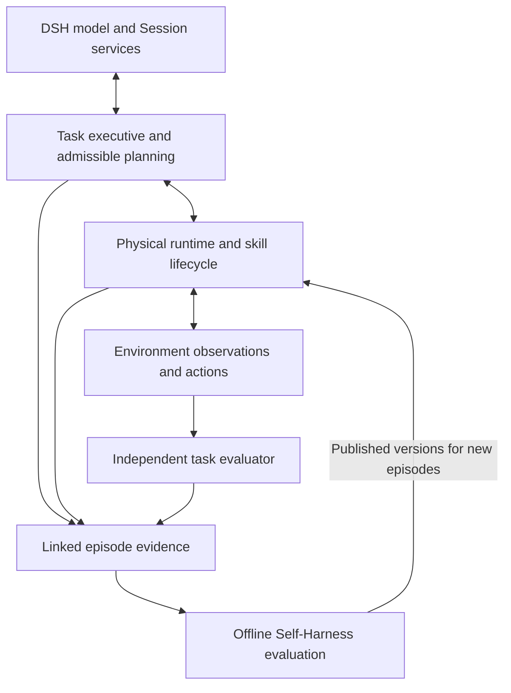

# Agent Note: Embodied domain harness optimization goals and technical design

Status: proposed

English | [中文](2026-10-23-embodied-domain-harness-optimization.zh.md)

## Problem

The [Thinking diagnostic](../../../../python/embodied/evaluations/2026-10-21-thinking/report.md) separates several limits that stronger reasoning alone cannot resolve: incomplete executable skills, unqualified learned-policy adaptation, inaccurate capability selection, repeated unsuccessful recovery, and unnecessary control-path overhead. A domain harness must connect task requirements to executable capabilities, observed progress and bounded recovery before model configuration can improve the complete task reliably.

The following evidence comes from retained development experiments and frozen-source inspection, not new measurements performed for this proposal. The report remains the owner of sample counts, raw evidence and experimental limitations. Formal held-out outcome acceptance has not run.

| Evidence | Supported diagnosis | Optimization consequence |
|---|---|---|
| Toolbox completion requires four tools, but the inspected program executes only `moves[:1]` with tape-specific geometry. | Correct routing cannot supply the missing manipulation behavior. | Verify required subgoal coverage and implement missing skills before claiming complete-task improvement. |
| Nine pi05 episodes fail with zero planner calls. | These failures occur below the planning decision; checkpoint, preprocessing, control conventions and task coverage remain unresolved. | Qualify execution independently before comparing planners. |
| Confirmed skill failure reaches real replanning, then repeats the failed capability and proposes an unadmitted replacement; H1 dispatches no actions and consumes three calls. | Recovery transport works, but useful recovery selection is unproven. | Supply actionable failures and phase-admissible candidates, and prevent unchanged failed attempts. |
| Clarified online inputs admit 25/25 responses with both off and high Thinking; median API times are 1.93 and 2.98 seconds. | High effort has no demonstrated admission advantage on these five repeated snapshots. | Compare reasoning effort by decision class; do not generalize to untested complex inputs. |
| The local-storage eight-command hold completes in 35.12 seconds for N and 67.92 for H1, both successfully. | This intervention causes unnecessary high-level recovery. | Detect task/skill progress and measure false recovery, not only joint motion. |
| Local synchronous writes are faster in the probe; cooperative worker closing removes a measured forced-kill delay. | Storage and lifecycle costs are actionable independently of reasoning. | Retain the verified mechanisms and measure complete cold/warm episodes before further optimization. |

## Proposal

Develop an explicit embodied task runtime around the existing Python execution interfaces, while reusing DSH model invocation, Session history and offline jobs. PhysicalRSI remains responsible for skill implementation and execution; runtime observation and control providers establish physical facts. The evaluator independently judges task success. Domain behavior attaches through the public SDK and documented DSH extension points, without adding robot control to the general agent loop.

This proposal supplements the [integration and evaluation proposal](2026-10-20-physicalrsi-phase-one-integration.md). That proposal remains active and owns compatibility behavior, comparison arms, formal G1–G4 acceptance and offline F1–F4 admission. This document owns capability-qualified task execution, admissible planning inputs, failure-aware recovery and the optimization sequence derived from the diagnostic.

### Optimization goals

The table defines desired outcomes, not achieved results. Formal outcome thresholds inherit the original proposal, including its paired one-sided confidence bounds, task-family requirements, sample-size calculation and failure accounting. Diagnostic targets below are additional proposed engineering criteria; freeze their cases, denominators and thresholds before measuring the candidate.

| Goal | Target | Verification owner |
|---|---|---|
| Executable coverage | Every required subgoal in the declared supported task scope has an implementation and independent execution evidence; unsupported or unknown coverage is explicit. Loading weights or emitting actions does not satisfy coverage. | PhysicalRSI skill owner and independent evaluator. |
| Valid selection | Zero dispatches from inadmissible, stale or unvalidated decisions; zero planning calls when the executable candidate set is empty and no approved observation action is available. | Domain candidate resolver and execution coordinator. |
| Useful recovery | Zero repeat attempts for a confirmed persistent failure with unchanged relevant conditions; all recovery calls and rejected proposals consume shared episode budgets. | Failure policy and runner evidence audit. |
| Progress detection | On a frozen diagnostic set, unnecessary recovery in at most 5% of no-recovery-needed episodes and detection of at least 95% of injected, observable, recoverable events within their configured deadlines. Report intervals and event categories separately. | Observer owner; evaluator labels are used only offline. |
| Basic task quality | Inherit G1: basic-task success-rate difference lower bound at least −2 percentage points, including every required task family. | Paired evaluation owner. |
| Basic time and cost | Inherit G2: capped-completion p50/p95 time-ratio and mean model-cost-ratio upper bounds at most 1.10; preserve zero additional calls on the designated zero-call baseline tasks. | Paired evaluation owner. |
| Complex task benefit | Inherit G3: long-horizon and recoverable-disturbance sets each reach at least +10 percentage points estimated success gain and +5 points lower bound, with the original per-family protections. | Paired evaluation owner. |
| Execution integrity | Inherit G4: no action before confirmed stopping during replacement, stale plan application, duplicate commit or hard-constraint bypass; every accepted model input and physical outcome is traceable. | Runtime owner and independent evidence audit. |

Coverage is a prerequisite, not a success-rate result. A diagnostic target passing does not pass G1–G4. If capability coverage prevents a meaningful formal comparison, report the scope as unready and revise it before held-out evaluation; never remove failures after observing evaluation results.

### Responsibilities and existing implementation points

Keep one owner for live physical state and one authoritative capability catalog. The proposed domain types below are design names, not shipped public APIs or new package commitments.

| Component | Responsibility | Existing implementation point |
|---|---|---|
| DSH planner and context | Model route, bounded requests, durable model-visible input/output and decision history. | [PlannerBridge](../../../../python/embodied/src/deepseek_harness_embodied/bridge.py) and [planner bundle](../../../../packages/experimental/embodied-planner/README.md). |
| Task executive and candidate resolver | Subgoal state, capability coverage, phase-admissible choices, failure policy and request construction. | Extend [OnlineModel](../../../../python/embodied/src/deepseek_harness_embodied/online_model.py); extract focused domain modules as responsibilities become concrete. |
| Runtime and observers | Sensor-derived facts, skill progress, action dispatch, stop acknowledgement and result verification. | [RecoveryCoordinator](../../../../python/embodied/src/deepseek_harness_embodied/recovery.py) and [RoboDojo consumer](../../../../python/embodied/src/deepseek_harness_embodied/robodojo.py). |
| Skill execution providers | Typed inference failures, native skill lifecycle and version-pinned implementation. | [Native binding](../../../../python/embodied/src/deepseek_harness_embodied/native_binding.py), [process binding](../../../../python/embodied/src/deepseek_harness_embodied/process_binding.py) and PhysicalRSI skill providers. |
| Evaluation and offline development | Independent success, controlled experiments, candidate validation and publication. | [Pilot report](../../../../python/embodied/src/deepseek_harness_embodied/pilot_report.py), [online evidence audit](../../../../python/embodied/src/deepseek_harness_embodied/online_evidence.py) and PhysicalRSI Self-Harness. |

### 1. Qualify executable capabilities

Add a versioned `CapabilitySpec` associated with the existing PhysicalRSI catalog entry: supported manipulation and geometric conditions, required sensor/control interfaces, checked parameters and units, observable start/completion predicates, interrupt/restart support, and evidence references. Keep `verified`, `unsupported` and `unverified` scope results distinct. Offline qualification records retain benchmark identities and scores; the model receives only deployment-approved capability facts and current observable conditions, never held-out identifiers or score priors.

Build the task's required subgoals from the user instruction and allowed perception. Match each subgoal to supported effects; broad semantic similarity is insufficient. A missing condition remains unknown, and only an explicitly registered observation action may resolve it. Such an action needs its own admissibility, timeout and evidence rules; the first increment may stop on unknown conditions instead of inventing sensing behavior.

For toolbox storage, independently implement and validate each required object's perception, grasp, orientation, placement and completion check. Removing `moves[:1]` alone does not supply object-specific control. Until that coverage exists, use the inspected case to test explicit capability insufficiency; do not use it to demand successful recovery from an incapable catalog.

For learned policies, first run explicit bindings without planner calls. Compare checkpoint/configuration, camera order and preprocessing, state normalization, joint/arm order, gripper encoding, absolute versus delta actions, frames, units and control cadence against the provider's supported inference path. Retain observations, preprocessed inputs, action conversion and task outcomes. A successful minimal task establishes only its measured scope; qualify pi05 and sparse-memory policies separately.

### 2. Execute and verify subgoals

Introduce `SubgoalState` with dependencies, status, selected capability/version, attempt identity, expected effects and evidence references. Start with a serialized dependency graph on one environment. The executive advances a subgoal only after an allowed observation verifies its effect and the runtime confirms no old queued/in-flight actions remain. Model completion, action generation, subgoal completion and native task success are separate events.

Extend skill adapters to report progress, termination and safe interruption points. A provider without these semantics cannot be decomposed by relabeling its internal stages. Preserve whole-skill execution where it is the only verified interface. Parameters are accepted only through an implemented, versioned skill schema with frame/unit validation; the initial increment retains registered operation IDs where no parameterized provider exists.

An `ObservationSnapshot` carries episode/generation, sensor sequence, acquisition time, frame/unit metadata, known/unknown predicates and evidence references. Model context separates current facts, historical triggers and unresolved failures. If a later observation invalidates an earlier subgoal effect, the executive marks that effect unknown or failed and revisits its dependants. Summaries cannot establish current physical state or resume authority.

### 3. Resolve admissible decisions before inference

Compute a `CandidateSet` from the frozen catalog, current subgoal, fresh snapshot, execution phase, known failed attempts and remaining budgets. Evaluate initial-bind requirements separately from restart/switch requirements. Classify each catalog entry as admissible, rejected or unresolved. Proven violations or missing mandatory execution support reject an entry; unknown mandatory conditions remain unresolved and cannot enter the executable candidate list. Retain all exclusion and uncertainty reasons for diagnosis.

Expose the currently admissible candidate IDs and their checked requirements to the planner. Keep catalog identity stable while recording a new candidate-set revision per decision. Include the candidate-set revision, snapshot sequence and parent plan in the proposal. Revalidate all three immediately before commit because inference can outlive the observation's validity. No candidates produces an explicit stopped outcome without a model call unless an approved observation action can resolve the gap.

Define a discriminated `PlanDecision`: execute a supplied candidate for a named subgoal, request a supplied observation action, or stop with a structured reason. A stop decision must not require a fictitious composition or operation. Derive the prompt's field instructions and local validation from one domain definition; provider JSON-object output alone does not enforce this definition. Preserve native compatibility requests unchanged; the enhanced protocol gets an explicit version.

### 4. Make failures useful to recovery

Extend the [typed skill failure](../../../../python/embodied/src/deepseek_harness_embodied/skill_failure.py) with provider-authored reason codes, affected capability/subgoal, relevant observed predicates, known/partial/unknown effects and declared retry conditions. Examples include a missing required observation, unsupported geometry and unavailable inference dependency. Do not infer these categories by parsing arbitrary exception messages. Unknown defects remain unknown; private diagnostic text stays outside model input.

Keep a bounded attempt history keyed by subgoal, capability version and failure category. A persistent incompatibility is not retried until its relevant predicate changes. A new image digest or observation sequence alone is insufficient evidence of such a change. Transient failures may use the provider's reviewed retry policy within configured limits. Missing dependencies are deployment failures, not reasons to repeat the same online plan.

Recovery escalates from provider-local correction, to a supported stage restart, to an admissible alternative capability, to task revision or an explicit stop. Each level declares its deadline and owner. Unknown action or stop outcomes prohibit automatic continuation. Cleanup-confirmed inference failure still requires runner-owned physical stop acknowledgement and a fresh observation before replacement; no failure code can bypass that ordering.

### 5. Monitor semantic progress and control time

Replace the single joint-stall decision with provider-supported phase monitors: approach progress, contact/holding state, transport progress and placement verification where observable. Waiting/contact phases use reviewed expectations rather than assuming low joint motion is failure. Configure observation windows, debounce, hysteresis, local-recovery grace time and maximum no-progress duration by capability/phase, and freeze them before comparison.

Track false recovery per negative-control episode and event detection on the separately labelled disturbance set. Report detection and recovery delays, repetitions and final task success together. A monitor that improves recall by stopping healthy executions fails its false-recovery target. The current single-environment simulator remains the first supported target; physical-device support additionally requires independent monitoring during model calls and device-specific stop guarantees.

Preregister normal execution and benign interruptions as negative controls; do not select them retrospectively from native successes. An episode with any unnecessary high-level recovery counts once in the false-recovery numerator. Event recall uses all actually injected observable events, with per-category deadlines fixed before execution; separately report assigned episodes where injection was never reached, and retain them in the task-success denominator. These diagnostic point targets require reported sample counts and intervals, not a universal reliability claim.

### 6. Allocate reasoning and reduce measured overhead

Compare off/low/high effort on frozen decision classes: ordinary initial selection, ambiguous selection, transient recovery and multi-subgoal revision. First validate current-versus-historical state encoding and the exact plan fields. Select a deployment policy using development data and freeze it before held-out runs. The clarified pickup snapshots justify testing lower effort, not assuming that lower effort works for every task.

All model attempts, format repairs and effort escalations share episode time/token/call budgets and remain in the evidence ledger. Expose repair and escalation limits as validated configuration; keep dispatch stopped during these operations. A truncated answer never becomes a plan. Adding per-decision effort must preserve the episode Session and durable request settings; do not rotate the runtime merely to change effort or discard failed history.

Use local durable evidence storage and the verified cooperative worker shutdown as the first deployment baseline, identically across comparison arms. Preserve commit-before-dispatch and immutable records. Investigate the measured repeated configuration parsing/hashing using an owned immutable runtime snapshot with explicit reload/rejection semantics; an unchecked cache cannot replace runtime configuration integrity. Consider resident weights separately from execution-state lifetime only when a provider can verify reset and isolation.

Measure cold start, first action, observation processing, policy inference, model planning, synchronous evidence writes, stop/rebind and terminal time separately, alongside full-episode latency and peak memory. Re-run the complete path after each isolated intervention. Do not claim end-to-end gains from the local/NAS write ratio or weaken durability to pass latency targets.

### 7. Link experience to independently evaluated improvements

Link observation, subgoal, candidate set, plan, skill attempt, action, failure and native outcome through stable episode/revision IDs. Keep high-rate trajectory data in the execution evidence store and persist every model-visible projection and its references through DSH. The execution runtime owns physical truth; Session replay explains decisions but does not authorize replaying actions after a restart.

Adapt completed development evidence to PhysicalRSI's existing `DevelopmentExperience` and `ExperienceCompiler`. Offline candidates can improve a skill, capability description or recovery rule, but require independent evaluation and publication under the original F1–F4 obligations. New versions apply only to new episodes. Keep the fixed-catalog online experiment separate from skill development, and let native and enhanced planners consume the same improved catalog when measuring catalog benefit.

### Delivery sequence and compatibility

Each increment carries its owning implementation, documentation, focused tests and evidence. Existing source paths identify integration points, not a requirement to keep all new behavior in one class. Add a separate domain module only with a real producer and consumer.

| Increment | Deliverable and responsible owner | Prerequisite and completion evidence |
|---|---|---|
| A: execution qualification | PhysicalRSI owners produce capability coverage records and resolve learned-policy adaptation; evaluator owners verify per-subgoal outcomes. | Frozen sources/dependencies and zero-planner binding runs. Unsupported toolbox behavior is explicit; each claimed supported effect has execution evidence. |
| B: admissible recovery | Adapter owners add candidate resolution, structured failures, attempt limits and a proper stop decision. | A's catalog metadata. Fault injection rejects unavailable/stale choices, prevents unchanged persistent retries and demonstrates an actual successful alternative where one exists. |
| C: task execution | Runtime owners add subgoal state, skill progress adapters, effect verification and phase monitors. | A's executable coverage and B's admission rules. At least three dependent subgoals, revisited invalidated effects, negative controls and recoverable disturbances. |
| D: planning and performance | DSH/adapter owners compare reasoning policies, preserve episode context and remove measured storage/configuration/lifecycle costs. | Stable B/C behavior. One-factor comparisons, cold/warm endpoints, peak memory and preserved execution evidence. |
| E: formal outcome evaluation | Evaluation owners freeze N/H0/H1 and ablations, then execute the original G1–G4 protocol. | A–D ready, supported-scope and strongest-native qualification complete, fresh held-out assignments. Report all failures and intervals. |
| F: offline improvement | Self-Harness owners import qualified development evidence and evaluate/publish candidates. | Linked episode evidence and original F1–F4 controls. Fixed/improved catalog comparisons and budget-matched native development. |

The initial scope is one RoboDojo environment with registered skills. Multi-robot scheduling, unverified new sensors, online arbitrary code generation, and physical-device qualification are separate work. Maintain the native N and compatibility H0 paths as experimental controls; any shared provider fix applies to all relevant arms.

Version changed plan/failure/evidence protocols explicitly and update all consumers and audits together. Preserve old experiment evidence with its producing schema; do not reinterpret or overwrite it. Before implementation changes a persisted DSH type or a public configuration/API, follow the repository's persistence acknowledgement and upgrade-guide requirements. This proposal itself changes no runtime API or default.

## Alternatives considered

| Alternative | Why it is not the primary design |
|---|---|
| Enable high Thinking globally or enlarge every output budget. | It does not supply missing executable behavior, and the diagnostic shows additional latency without universal admission benefit. |
| Fix only capability descriptions. | Better descriptions help selection but cannot implement the missing toolbox control or establish policy adaptation. |
| Restart whenever motion stalls or a worker fails. | It repeats persistent incompatibilities and can interrupt native recovery; physical stop and uncertainty handling still require explicit ownership. |
| Put robot-specific branches in the general DSH loop. | It mixes model-turn completion with physical execution and duplicates the existing runtime's ownership. |
| Build a second skill registry and evolutionary framework inside DSH. | PhysicalRSI already owns catalog versions, independent evaluation and publication; a second authority would create inconsistent admission and release state. |
| Remove synchronous evidence persistence to reduce latency. | The measured local-storage option preserves evidence ordering; changing durability requires a separate failure model and is not justified by the present data. |

## Acceptance criteria

Increment A’s execution checks and provider patches are recorded in the [initial execution record](../../../../python/embodied/evaluations/2026-10-23-execution-qualification/report.md); the [renderer restoration and physical trials](../../../../python/embodied/evaluations/2026-10-23-execution-qualification/renderer-restoration.md) complete the six assigned native trials. Capability support follows the scoped audited outcomes, including unsuccessful tasks; this does not qualify the remaining increments or formal G1–G4.

Engineering acceptance and outcome acceptance are separate. Use the following layers in order; reaching a later layer never excuses a failed earlier invariant. This document records proposed verification, not completed tests or simulator qualification.

| Layer | Required evidence and negative cases |
|---|---|
| Capability execution | Explicit binding without model calls; verify each required supported effect and reject mismatched frames/units, missing mandatory observations and unsupported effects. Retain failed policy preflights. |
| Domain decisions | Pure admission/state tests plus assembled SDK/profile replay: valid candidates pass; unknown mandatory conditions, missing restart support, stale candidate sets, exhausted budgets and invalid fields cannot dispatch. Empty candidate sets consume no planning call. |
| Failure and lifecycle | Exercise confirmed inference failures separately from RPC loss, unknown action outcomes, missing stop acknowledgement and cleanup failure. Persistent unchanged failures do not repeat; allowed transient retries consume their limits. |
| Task progression | A real executor completes at least three dependent subgoals in each of the original required long-horizon task families; incorrect/missing effects do not advance state, and invalidated effects reopen their dependants. |
| Progress and reasoning | Freeze the negative controls and observable disturbances for the 5%/95% diagnostic targets. Compare effort with identical input/history within each class; retain truncation, invalid-plan and timing results. Add keyless snapshots for every new model-visible state/failure projection. |
| End-to-end attribution | Compare native N, compatibility H0, enhanced H1, recovery-disabled and history-disabled variants under the original budgets. Add a deterministic recovery control with the same stop/admission rules and model configuration to isolate the value of LLM recovery decisions. |
| Release outcome | Pass the original G1–G4 jointly on independent held-out sets. Freeze baseline selection, source/catalog versions, thresholds, budget accounting and statistical analysis before unblinding. Apply the original sample-size/power and failure-denominator rules. |
| Offline development | Validate evidence integrity and development partition, evaluate candidates independently, reject publication conflicts and apply releases only to new episodes under F1–F4. |

The deterministic recovery control uses only runtime-observable triggers and reviewed rules; it receives no disturbance labels or extra actions. Report partial goal completion separately from final task success. All arms share the allowed sensor inputs, skill versions, physical/time/model resource limits and independent success checks. Skill improvements, prompt clarification, reasoning configuration and recovery policy remain separate experimental factors.

## Risks

Incomplete capability metadata can either admit an unsafe choice or hide a usable one. Preserve unknown conditions and exclusion reasons, audit candidate recall on qualified development cases, and never turn benchmark scores into online routing hints. Object-specific control and learned-policy adaptation may require substantially more work than the adapter changes.

Progress monitors can mistake contact or native recovery for failure. The proposed 5%/95% diagnostic targets may require revision during development; any revision must precede the frozen acceptance run and carry a reason. Observation latency can invalidate a plan during inference, so execution must revalidate independently of model confidence.

Resident workers and cached configuration reduce costs only if isolation, identity and cleanup remain verifiable. Unknown cleanup or dispatch outcomes keep execution stopped. A simulator's paused planning interval does not establish safe physical-device behavior, and this proposal makes no such qualification claim.

Small repeated development scenes can overfit capability descriptions, effort selection and recovery thresholds. Keep their evidence for diagnosis, exclude them from held-out qualification, retain every assigned failure, and report insufficient evidence when budgets or statistical precision do not support the required outcome.
