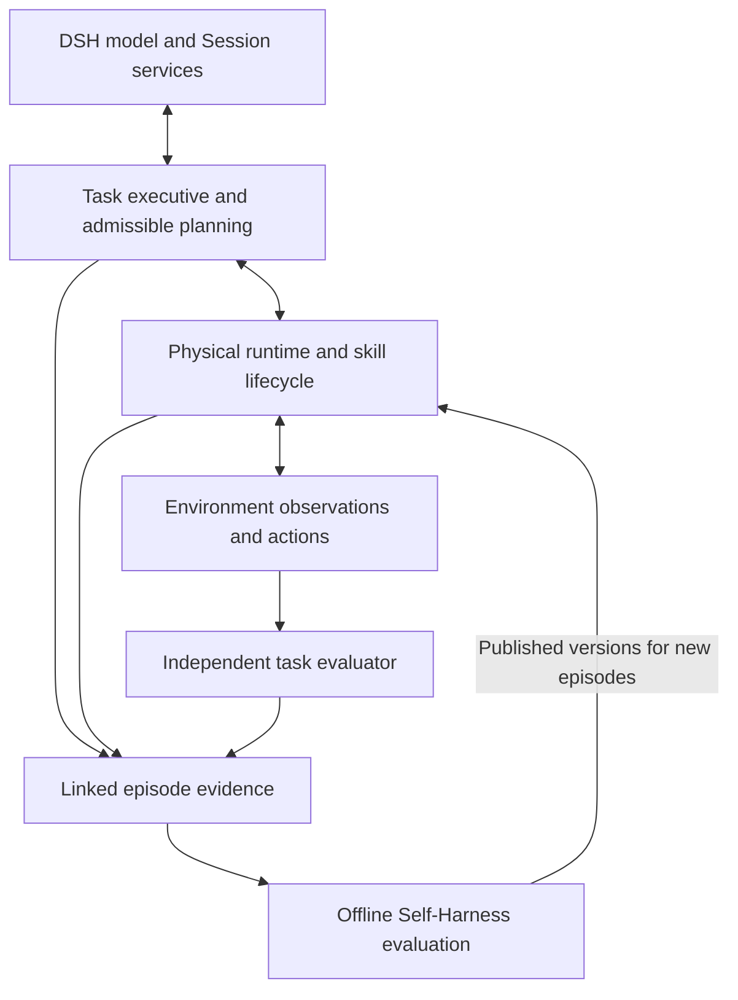

# Agent Note: 具身领域 harness 优化目标与技术方案

Status: proposed

[English](2026-10-23-embodied-domain-harness-optimization.md) | 中文

## 问题

[Thinking 诊断](../../../../python/embodied/evaluations/2026-10-21-thinking/report.zh.md)区分了更强推理无法独自解决的限制：可执行 skill（技能）不完整、学习策略适配未经验证、能力选择不准确、重复无效恢复，以及不必要的控制路径开销。领域 harness 需要先将任务要求连接到可执行能力、可观测进度和有界恢复，模型配置才可能可靠地改善完整任务结果。

以下证据来自已保留的开发实验和冻结源码检查，并非编写本方案时进行的新测量。报告继续负责样本数量、原始证据和实验局限。正式留出效果验收尚未运行。

| 证据 | 支持的诊断 | 优化方向 |
|---|---|---|
| 工具箱任务要求四件工具，但检查的程序仅执行 `moves[:1]`，并使用卷尺专用几何参数。 | 正确路由无法补齐缺失的操作行为。 | 声明完整任务改进前，验证必要子目标覆盖并实现缺失的 skill。 |
| 九次 pi05 episode 在零规划调用下失败。 | 失败发生在规划决策之下；检查点、预处理、控制约定和任务覆盖仍未确定。 | 比较规划器之前，独立验证执行能力。 |
| 已确认 skill 故障进入真实重规划，随后重复失败能力并提出未获准的替换；H1 派发零个动作、消耗三次调用。 | 恢复通信链路已通，但有效恢复选择尚未证明。 | 提供可指导处理的失败信息和按阶段准入的候选，阻止条件未变的失败尝试。 |
| 澄清后的在线输入在 Thinking 关闭和 high 时均准入 25/25；API 中位时间为 1.93 和 2.98 秒。 | 在这五个重复快照上，high 尚无已证明的准入优势。 | 按决策类别比较推理强度，不推广到未经测试的复杂输入。 |
| 本地存储的八次指令保持条件下，N 用时 35.12 秒，H1 用时 67.92 秒，均成功。 | 该扰动触发了不必要的高层恢复。 | 检测任务和 skill 进度，测量误恢复，而不只看关节运动。 |
| 本地同步写入在探针中更快；协作关闭工作进程消除了一项已测得的强制终止延迟。 | 存储和生命周期成本可独立于推理优化。 | 保留已验证机制，并在继续优化前测量完整冷、热启动 episode。 |

## 提案

围绕现有 Python 执行接口建立显式的具身任务运行时，复用 DSH 的模型调用、Session 历史和离线作业。PhysicalRSI 继续负责 skill 实现与执行；运行时观测和控制提供方确认物理事实。评测器独立判定任务成功。领域行为通过公共 SDK 和已记录的 DSH 扩展点接入，不将机器人控制加入通用 agent loop（智能体循环）。

本方案补充[集成与评测方案](2026-10-20-physicalrsi-phase-one-integration.zh.md)。原方案保持有效，负责兼容行为、对照组、正式 G1–G4 验收和离线 F1–F4 准入。本文负责经过能力验证的任务执行、可准入规划输入、失败驱动恢复，以及诊断所确定的优化顺序。

### 优化目标

下表定义预期结果，不代表已经实现。正式效果门槛继承原方案，包括配对单侧置信界、任务族要求、样本量计算和失败计数规则。下列诊断目标是新增的拟议工程标准；测量候选版本之前，冻结场景、分母和阈值。

| 目标 | 指标 | 验证责任方 |
|---|---|---|
| 可执行覆盖 | 声明支持范围内的每个必要子目标均有实现和独立执行证据；明确标记不支持或覆盖未知。权重加载、动作输出不能满足覆盖要求。 | PhysicalRSI skill 维护者与独立评测器。 |
| 有效选择 | 不准入、陈旧或未验证决策的动作派发为零；可执行候选集为空且无获准观测动作时，规划调用为零。 | 领域候选解析器与执行协调器。 |
| 有效恢复 | 已确认持续性失败且相关条件未变时，重复尝试为零；所有恢复调用和被拒提案计入共同 episode 预算。 | 失败策略与运行器证据审计。 |
| 进度检测 | 冻结诊断集上，无需恢复的 episode 中不必要恢复比例不超过 5%；对已注入、可观测、可恢复事件，在配置截止时间内的检测率至少 95%。分事件类别报告区间。 | 观测器维护者；评测标签仅供离线使用。 |
| 基础任务质量 | 继承 G1：基础任务成功率差值下界至少为 −2 个百分点，包括每个必测任务族。 | 配对评测维护者。 |
| 基础耗时与费用 | 继承 G2：截断完成耗时 p50/p95 比值及平均模型费用比值的上界不超过 1.10；指定零调用基线任务保持零新增调用。 | 配对评测维护者。 |
| 复杂任务收益 | 继承 G3：长程与可恢复扰动集合分别达到至少 +10 个百分点的成功率差值点估计和 +5 个百分点的下界，并保留原任务族保护要求。 | 配对评测维护者。 |
| 执行完整性 | 继承 G4：替换时未确认停止便执行、陈旧计划生效、重复提交、绕过硬约束均为零；每项已接受的模型输入和物理结果可追溯。 | 运行时维护者与独立证据审计。 |

覆盖是前置条件，不是成功率结果。诊断目标通过不代表 G1–G4 通过。如果能力覆盖使正式比较无法有效进行，应报告范围未就绪，并在留出评测前修订；不得在看到评测结果后删除失败。

### 职责与现有实现位置

实时物理状态和权威能力目录分别保持唯一负责人。下列领域类型是设计名称，并非已交付公共 API 或新增包的承诺。

| 组件 | 职责 | 现有实现位置 |
|---|---|---|
| DSH 规划与上下文 | 模型路由、有界请求、持久化模型可见输入输出及决策历史。 | [PlannerBridge](../../../../python/embodied/src/deepseek_harness_embodied/bridge.py) 和[规划组合包](../../../../packages/experimental/embodied-planner/README.zh.md)。 |
| 任务执行器与候选解析器 | 子目标状态、能力覆盖、按阶段准入的选择、失败策略和请求构造。 | 扩展 [OnlineModel](../../../../python/embodied/src/deepseek_harness_embodied/online_model.py)；职责明确后抽取专门领域模块。 |
| 运行时与观测器 | 传感器事实、skill 进度、动作派发、停止确认与结果验证。 | [RecoveryCoordinator](../../../../python/embodied/src/deepseek_harness_embodied/recovery.py) 和 [RoboDojo 消费方](../../../../python/embodied/src/deepseek_harness_embodied/robodojo.py)。 |
| skill 执行提供方 | 类型化推理失败、原生 skill 生命周期与固定版本实现。 | [原生绑定](../../../../python/embodied/src/deepseek_harness_embodied/native_binding.py)、[进程绑定](../../../../python/embodied/src/deepseek_harness_embodied/process_binding.py) 和 PhysicalRSI skill 提供方。 |
| 评测与离线开发 | 独立成功判定、受控实验、候选验证和发布。 | [试验报告](../../../../python/embodied/src/deepseek_harness_embodied/pilot_report.py)、[在线证据审计](../../../../python/embodied/src/deepseek_harness_embodied/online_evidence.py) 和 PhysicalRSI Self-Harness。 |

### 1. 验证可执行能力

为现有 PhysicalRSI 目录项关联版本化 `CapabilitySpec`：支持的操作与几何条件、所需传感和控制接口、经过校验的参数与单位、可观测的启动和完成谓词、中断与重启支持，以及证据引用。区分范围验证结果 `verified`、`unsupported` 和 `unverified`。离线验证记录保留 benchmark 标识与评分；模型仅接收部署允许的能力事实和当前可观测条件，不接收留出标识或评分先验。

从用户指令和允许的感知中建立任务必要子目标，逐项匹配受支持的效果；宽泛的语义相似性不足以完成匹配。缺失条件保持未知，只有显式注册的观测动作可以消除未知。该动作也需要自身的准入、超时和证据规则；首个增量可在条件未知时停止，不虚构感知行为。

工具箱收纳需要独立实现并验证每件必要工具的感知、抓取、朝向、放置与完成检查。仅删除 `moves[:1]` 不会补齐对象专属控制。在覆盖完整之前，用检查过的案例测试显式能力不足，不要求能力不完整的目录实现成功恢复。

学习策略先执行不调用规划器的显式绑定。对照提供方支持的推理路径，检查检查点与配置、相机顺序和预处理、状态归一化、关节及左右臂顺序、夹爪编码、绝对或增量动作、坐标系、单位和控制节奏。保留观测、预处理输入、动作转换及任务结果。最小任务成功仅证明其测量范围；分别验证 pi05 与稀疏记忆策略。

### 2. 执行并验证子目标

引入 `SubgoalState`，包含依赖关系、状态、选定能力及版本、尝试标识、预期效果和证据引用。先支持单环境上的串行依赖图。只有允许的观测验证了效果，且运行时确认没有旧的排队或在途动作，执行器才推进子目标。模型完成、动作生成、子目标完成和原生任务成功分别记录。

扩展 skill 适配器，报告进度、终止和安全中断点。缺少这些语义的提供方，不能仅通过重新标注内部阶段实现拆分。如果唯一验证过的接口是完整 skill 执行，则保留该接口。参数只通过已实现、版本化且校验坐标系和单位的 skill schema 接受；没有参数化提供方时，首个增量继续使用注册的 operation ID。

`ObservationSnapshot` 包含 episode 和代次、传感序号、采集时间、坐标系及单位元数据、已知或未知谓词以及证据引用。模型上下文区分当前事实、历史触发和未解除失败。如果后续观测使此前子目标效果失效，执行器将其标记为未知或失败，并重新检查依赖项。摘要不能确认当前物理状态，也不能授权恢复执行。

### 3. 推理前解析可准入决策

根据冻结目录、当前子目标、新鲜快照、执行阶段、已知失败尝试和剩余预算计算 `CandidateSet`。分别检查首次绑定和重启、切换的要求。将每个目录项分类为可准入、已拒绝或未确定。已证明违反要求或缺少必要执行支持时拒绝该项；必要条件未知时保持未确定，不能进入可执行候选列表。保留所有排除和不确定原因供诊断。

向规划器提供当前准入的候选 ID 及其已检查要求。目录标识保持稳定，每次决策记录新的候选集版本。提案携带候选集版本、快照序号和父计划。推理可能超过观测有效期，因此提交前重新验证这三项。没有候选时直接产生显式停止结果，不调用模型，除非获准观测动作可以消除缺口。

定义带判别字段的 `PlanDecision`：为指定子目标执行已提供的候选、请求已提供的观测动作，或携带结构化原因停止。停止决策不得要求虚构的 composition 或 operation。从同一领域定义生成提示词字段说明和本地校验；提供方的 JSON-object 输出本身不执行该定义。原生兼容请求保持不变，增强协议使用显式版本。

### 4. 让失败信息指导恢复

扩展[类型化 skill 失败](../../../../python/embodied/src/deepseek_harness_embodied/skill_failure.py)，增加提供方定义的原因码、受影响能力与子目标、相关观测谓词、已知或部分或未知效果，以及声明的重试条件。例如缺少必要观测、几何不受支持、推理依赖不可用。不得通过解析任意异常消息推断类别。未知缺陷保持未知，私有诊断文本不进入模型输入。

按子目标、能力版本和失败类别维护有界尝试历史。持续性不兼容在相关谓词变化前不得重试。新图像摘要或观测序号本身不足以证明该变化。暂时性失败可在配置限制内使用提供方已审核的重试策略。依赖缺失属于部署失败，不能成为重复同一在线计划的理由。

恢复依次从提供方局部纠正，升级到受支持的阶段重启、可准入替代能力，再到任务修订或显式停止。各级声明截止时间和负责人。动作或停止结果未知时禁止自动继续。已确认清理的推理失败仍需运行器确认物理停止并取得新观测，才能替换；任何失败码都不能绕过该顺序。

### 5. 监测语义进度与控制时间

以提供方支持的阶段监测替代单一关节停滞决策：在可观测范围内检查接近进度、接触或持握状态、搬运进度和放置结果。等待或接触阶段使用经过审核的预期，不假定低关节运动就是失败。按能力和阶段配置观测窗口、防抖、滞回、局部恢复宽限时间及最大无进展时长，并在比较前冻结。

按负对照 episode 统计误恢复，并在单独标注的扰动集统计事件检测。同时报告发现与恢复延迟、重复次数和最终任务成功。通过停止正常执行提高召回率的监测器不能通过误恢复目标。首个支持目标仍是当前单环境仿真；物理设备支持还要求模型调用期间独立监测，并具备设备专属停止保证。

预登记正常执行与良性中断作为负对照，不得事后从原生成功案例中选择。episode 只要发生任一次不必要的高层恢复，就在误恢复分子中计一次。事件召回以全部实际注入的可观测事件为分母，各类别截止时间在执行前固定；另报未到达注入时点的已分配 episode，并将其保留在任务成功分母中。诊断点估计目标必须同时报告样本数和区间，不构成普遍可靠性声明。

### 6. 分配推理预算并降低已测开销

在冻结决策类别上比较 off、low、high：普通首次选择、歧义选择、暂时性恢复、多子目标修订。先验证当前与历史状态编码及准确的计划字段。使用开发数据选择部署策略，在留出运行前冻结。澄清后的拾取快照支持测试较低强度，不代表所有任务都适用较低强度。

所有模型尝试、格式修订和推理升级共享 episode 时间、token 和调用预算，并保留在证据账本。通过经过校验的配置暴露修订与升级次数限制；执行期间保持停止派发。截断回答不得成为计划。增加按决策选择强度的能力时，必须保留 episode Session 和持久化请求设置；不能仅为改变强度轮换运行时或丢弃失败历史。

首先将本地持久证据存储和已验证的工作进程协作关闭作为各对照组一致的部署基线，保留先提交再派发和不可变记录。针对已测得的重复配置解析与哈希，研究由运行时持有的不可变快照及显式重载或拒绝语义；未经检查的缓存不能代替配置完整性。只有提供方能验证重置和隔离时，才独立考虑权重驻留与执行状态生命周期的分离。

分别测量冷启动、首个动作、观测处理、策略推理、模型规划、同步证据写入、停止与重绑、终止时间，同时记录完整 episode 时延和峰值内存。每次单因素修改后重跑完整路径。不得根据本地与 NAS 写入比值宣称端到端加速，也不得为达到时延目标削弱持久性。

### 7. 将经验连接到独立验证的改进

通过稳定的 episode 与版本 ID 关联观测、子目标、候选集、计划、skill 尝试、动作、失败和原生结果。高频轨迹数据保存在执行证据存储中，每项模型可见投影及其引用经 DSH 持久化。执行运行时持有物理事实；Session 回放用于解释决策，不能授权重启后重放动作。

将已结束的开发证据适配到 PhysicalRSI 现有 `DevelopmentExperience` 和 `ExperienceCompiler`。离线候选可以改善 skill、能力描述或恢复规则，但须按原 F1–F4 要求独立评估和发布。新版本只应用于新 episode。固定目录在线实验与 skill 开发分开；测量目录收益时，原生与增强规划器消费相同的改进目录。

### 交付顺序与兼容性

每个增量同时交付其所属实现、文档、聚焦测试和证据。现有源码路径用于定位接入点，不要求把全部新行为放在同一个类中。新增领域模块必须有实际生产方和消费方。

| 增量 | 交付物与责任方 | 前置条件及完成证据 |
|---|---|---|
| A：执行验证 | PhysicalRSI 维护者产出能力覆盖记录并解决学习策略适配；评测维护者验证各子目标结果。 | 冻结源码与依赖，运行零规划绑定测试。明确工具箱未支持行为，每个声明支持的效果均有执行证据。 |
| B：可准入恢复 | 适配器维护者增加候选解析、结构化失败、尝试限制和完整的停止决策。 | A 的目录元数据。故障注入拒绝不可用或陈旧选择，阻止条件未变的持续性失败重试，并在存在替代能力时演示真实成功替换。 |
| C：任务执行 | 运行时维护者增加子目标状态、skill 进度适配器、效果验证和阶段监测。 | A 的执行覆盖与 B 的准入规则。至少三个依赖子目标、失效效果重检、负对照和可恢复扰动。 |
| D：规划与性能 | DSH 和适配器维护者比较推理策略、保留 episode 上下文，并消除已测存储、配置和生命周期开销。 | 稳定的 B/C 行为。单因素对照、冷与热启动终点、峰值内存，以及完整执行证据。 |
| E：正式效果评测 | 评测维护者冻结 N/H0/H1 和消融组，再执行原 G1–G4 协议。 | A–D 就绪，支持范围和最强原生配置验证完成，使用新的留出分配。报告全部失败和区间。 |
| F：离线改进 | Self-Harness 维护者导入合格开发证据，并评估、发布候选。 | 关联的 episode 证据和原 F1–F4 控制。固定与改进目录对照，以及预算匹配的原生开发。 |

初始范围为一个 RoboDojo 环境和注册的 skill。多机器人调度、未经验证的新传感器、在线任意代码生成、物理设备验证属于独立工作。保留原生 N 和兼容 H0 路径作为实验对照；共享提供方修复应用于所有相关组。

显式版本化发生变化的计划、失败和证据协议，同时更新全部消费方与审计。旧实验证据保留其产生时的 schema，不重新解释或覆盖。实现若改变持久化 DSH 类型或公共配置、API，必须遵循仓库的持久化类型确认和升级指南要求。本提案自身不改变运行时 API 或默认值。

## 考虑过的替代方案

| 替代方案 | 未作为主要设计的原因 |
|---|---|
| 全局开启 high Thinking，或扩大所有输出预算。 | 无法提供缺失的执行行为；诊断显示时延增加，而准入收益并不普遍。 |
| 仅修正能力描述。 | 更好的描述有助于选择，但不能实现缺失的工具箱控制，也不能确认策略适配。 |
| 运动停滞或工作进程失败就重启。 | 会重复持续性不兼容，也可能打断原生恢复；物理停止和未知状态处理仍需明确负责人。 |
| 将机器人专属分支放进通用 DSH 循环。 | 混淆模型轮次完成与物理执行，并重复现有运行时职责。 |
| 在 DSH 内再建一套 skill 注册表和演化框架。 | PhysicalRSI 已负责目录版本、独立评估和发布；第二套权威会造成准入与发布状态不一致。 |
| 删除同步证据持久化以降低时延。 | 已测本地存储方案保留证据顺序；改变持久性需要独立失败模型，当前数据不足以支持。 |

## 验收标准

增量 A 的执行检查与提供方补丁记录在[初次执行记录](../../../../python/embodied/evaluations/2026-10-23-execution-qualification/report.zh.md)中；[渲染恢复与物理试验](../../../../python/embodied/evaluations/2026-10-23-execution-qualification/renderer-restoration.zh.md)完成六项已分配原生试验。能力支持以限定范围的审计结果为准，包含未成功任务，不代表其余增量或正式 G1–G4 通过。

工程验收与效果验收分开。依次使用以下层次；到达后续层次不能豁免此前的不变量失败。本文记录计划开展的验证，不代表已完成测试或仿真验证。

| 层次 | 必要证据与拒绝案例 |
|---|---|
| 能力执行 | 不调用模型的显式绑定；验证每项必要的受支持效果，拒绝坐标系或单位不匹配、必要观测缺失和不支持的效果。保留失败的策略预验证。 |
| 领域决策 | 纯准入与状态测试，加上实际 SDK/profile 组合回放：有效候选通过；必要条件未知、缺少重启支持、陈旧候选集、预算耗尽、无效字段均不能派发。空候选集不消耗规划调用。 |
| 失败与生命周期 | 分别覆盖已确认推理失败、RPC 丢失、动作结果未知、停止确认缺失和清理失败。持续且条件未变的失败不重复；获准暂时性重试消耗对应额度。 |
| 任务推进 | 在原方案要求的各长程任务族中，真实执行器完成至少三个依赖子目标；错误或缺失效果不能推进状态，失效效果重新打开依赖项。 |
| 进度与推理 | 为 5%/95% 诊断目标冻结负对照和可观测扰动。在各类别内以相同输入和历史比较推理强度，保留截断、无效计划和计时结果。每种新增模型可见状态或失败投影都有无密钥快照。 |
| 端到端归因 | 在原预算下比较原生 N、兼容 H0、增强 H1、禁用恢复和禁用历史的变体。增加具有相同停止、准入规则和模型配置的确定性恢复对照，隔离 LLM（大语言模型）恢复决策的价值。 |
| 发布效果 | 在独立留出集联合通过原 G1–G4。揭盲前冻结基线选择、源码和目录版本、阈值、预算核算及统计分析。遵循原样本量、功效和失败分母规则。 |
| 离线开发 | 校验证据完整性与开发分区，独立评估候选，拒绝发布冲突，并按 F1–F4 仅向新 episode 应用发布版本。 |

确定性恢复对照仅使用运行时可观测触发和已审核规则，不接收扰动标签或额外动作。局部目标完成与最终任务成功分别报告。所有组共享允许的传感输入、skill 版本、物理与时间及模型资源上限，以及独立成功检查。skill 改进、提示词澄清、推理配置和恢复策略保持为独立实验因素。

## 风险

不完整的能力元数据可能放行不安全选择，也可能隐藏可用能力。保留未知条件和排除原因，在已验证开发案例上审计候选召回，绝不将 benchmark 评分作为在线路由提示。对象专属控制和学习策略适配可能需要显著多于适配器改造的工作。

进度监测器可能将接触或原生恢复误判为失败。拟议的 5%/95% 诊断目标可能需要在开发阶段修订；任何修订必须早于冻结验收运行，并说明原因。观测延迟可能在推理期间使计划失效，因此执行必须独立于模型置信度重新校验。

只有隔离、身份和清理仍可验证时，驻留工作进程和缓存配置才有优化价值。清理或派发结果未知时保持停止。仿真暂停规划期间不能证明物理设备行为安全，本方案不作此类验证声明。

少量重复开发场景可能使能力描述、推理选择和恢复阈值过拟合。保留其诊断证据，将其排除在留出验证之外，保留每个已分配失败；预算或统计精度不足以支持要求时，报告证据不足。
